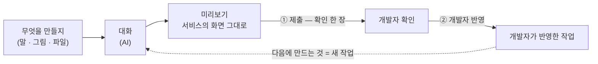

# ColoNova Design 사용 설명서

> 처음이라면 [README](../README.md) 부터 — 세 걸음이면 시작한다. 이 문서는 화면 하나하나,
> 버튼 하나하나를 적은 전체 안내다. 개발자 · 운영자 안내는 [DEVELOPERS.md](DEVELOPERS.md) 에 있다.

**목차** — [알아 둘 말](#알아-둘-말은-둘뿐이다) · [한 바퀴](#작업은-한-바퀴로-흘러간다) ·
[처음 한 번](#1-처음-한-번--체크리스트-한-장) · [틀](#2-틀--사이드바--상태-줄--대화--미리보기) ·
[홈](#3-홈--큰-입력창과-받은-편지함) · [준비](#4-처음-여는-프로젝트--준비) ·
[화면 만들기](#5-화면-만들기--말로) · [미리보기](#6-미리보기에서-확인) ·
[찍기](#7-고칠-곳은-찍어서--말풍선) · [제출](#8-제출--확인-한-장) ·
[코멘트](#9-개발자-코멘트--ai-가-반영한다) · [반영된 뒤](#10-반영된-뒤--받아오기는-내가-누른다) ·
[작업 기록](#마음이-바뀌면--작업-기록-서랍) · [설정](#설정--여섯-쪽) ·
[문제 문장](#화면의-문제-문장) · [문제가 생기면](#문제가-생기면) · [알아두면 편한 것](#알아두면-편한-것) ·
[자주 묻는 질문](#자주-묻는-질문)

## 알아 둘 말은 둘뿐이다

자리는 **홈 · 기획서 · 연결 · 화면** 넷이다. 홈은 기다리는 일을 보고 시작하는 현관이다.
화면은 Claude 처럼 대화와 **서비스의 실제 화면**이 나란히 서고, 그 위에 **상태 줄과 `제출`**이 있다.
(2026-10-23 화면 전면 재설계 — [ux-redesign-2026-10-23.md](ux-redesign-2026-10-23.md))

대화는 설명을 주고받는 자리이고, 화면과 제출은 **프로젝트 전체 작업**이다.
새 대화를 열어도 현재 화면은 그대로 이어진다. 다른 대화에서 만든 변경도 함께 제출된다.

- **제출** — 만든 것을 개발자에게 보낸다. 개발자에게 가는 일은 전부 이 말로 부른다.
  (AI 에게 말을 전하는 것은 `보내기` 다 — 두 뜻에 같은 말을 쓰지 않는다.)
- **개발자 반영 완료** — 개발자가 작업을 합쳤다. 실제 서비스 공개 여부는 담당자에게 확인한다.

**저장이라는 말은 없다** — AI 가 한 차례 답할 때마다 도구가 스스로 그 시점을 보관하므로,
누를 것은 `제출` 하나뿐이다. 보관된 차례들은 `작업 기록`에서 다시 보고 되돌릴 수 있다.

## 작업은 한 바퀴로 흘러간다

대화와 미리보기 위에 걸친 **상태 줄**이 지금 어디쯤인지 말한다. 왼쪽은 대화 제목이다 —
눌러서 그 자리에서 이름을 바꾼다(Enter 는 저장, Esc 는 그만두기. 사이드바가 접혀 있어도
된다). 오른쪽은 프로젝트 이름, 세 점의 여정, 그리고 `제출`이다. 프로젝트 이름에 마우스를 올리면
`프로젝트 이름 · 프로젝트 전체 작업`이 뜬다(2026-10-24 화면 전면 재설계 §4 G). 개발자가 반영한 내용이
있으면 여정과 `제출` 사이에 `받아오기 N` 이 선다([반영된 뒤](#10-반영된-뒤--받아오기는-내가-누른다)). 여정은
`제출 전 ─ 개발자 확인 ─ 개발자 반영` 이고 지금 점이 국면의 색을 옅게 깐 알(제출 전은 파랑 ·
개발자 확인은 호박색 · 반영은 초록, 막히면 빨강)로 서서 여기라고 말한다. 판정은 전부 기계적
신호(이번 작업에 보관된 것이 있는지, 개발자 쪽에서 보고하는 요청 상태)라 사람이 임의로 바꿀
수 없다.

| 지금 | 첫 점 | 둘째 점 | 셋째 점 |
| --- | --- | --- | --- |
| 아직 제출 전 | `제출 전 · 화면 N개` (막히면 `제출 전 · 제출하지 못했어요`) | `개발자 확인` | `개발자 반영` |
| 개발자에게 가 있음 | `제출됨` | `개발자 확인을 기다려요 · 코멘트 N` | `개발자 반영` |
| 개발자가 확인함 | `제출됨` | `개발자가 확인했어요` | `반영을 기다려요` |
| 합쳐짐 | `제출됨` | `확인됨` | `개발자 반영 완료` |

개발자 확인을 기다리는 동안 코멘트가 아직 없으면 둘째 점에 며칠째인지가 붙는다 — `개발자 확인을 기다려요 · 2일째`.
제출한 날이 1일째이고 자정이 지나면 하루씩 늘며, 제출한 날에는 아무것도 붙지 않는다. 코멘트가 오면 코멘트 수가 대신
서고, 개발자가 변경을 청한 요청이나 닫힌 요청에는 붙지 않는다. 가장 긴 문장(`· 코멘트 N`)보다 짧아 좁은 창의 접힘
순서는 그대로다(2026-10-07 UX 점검 3단계).

개발자가 요청을 승인하면 둘째 점이 지나온 점이 되어 `개발자가 확인했어요` 를, 셋째 점이 지금이 되어 `반영을 기다려요` 를
말한다(2026-10-07 베타 준비 분석). 「LGTM」 같은 말이 붙은 승인도 코멘트가 아니라 승인이다 — AI 가 고침 차례를 열지 않고 코멘트
수에도 들지 않는다. 변경을 청한 사람이 한 명이라도 있으면 승인으로 읽지 않는다.

AI 가 도는 동안은 여정 앞에 `만드는 중 · 12초` 가 붙는다(시계는 앱이 아니라 도구의
것이라, 창을 새로 열어도 실제 시작부터 이어 센다). 이때 여정의 테두리가 테마의 포인트
색으로 물들고 아래 끝을 따라 얇은 빛이 지나간다 — 글자를 읽기 전에 도는 중임이 보인다.

폭이 줄면 오른쪽의 프로젝트 이름, 지금이 아닌 점의 글자, `받아오기 N` 순으로 접힌다. AI 가 도는 동안에는
프로젝트 이름이 처음부터 숨는다. 이때 넓은 창에서는 지금 점의 글자 → `받아오기 N` → 시계 순으로 더 접힌다.
900px 보다 좁은 창에서는 대화 제목과 시계가 없고, `받아오기 N`이 지금 점의 글자보다 먼저 접힌다.
지금 점의 알과 `제출`은 끝까지 남는다. 접힌 내용과 `받아오기`는 `이번 작업`에서 본다.
(2026-10-24 화면 전면 재설계 §4 G · RP 검토의 넓은 창 예외 반영)

여정을 누르면 **`이번 작업`** 이 열린다 — 받아올 것이 있으면 맨 위의 `개발자 쪽 새 내용`(받아오기), 바뀐 화면(제목 · 한 줄 · 시각), 제출(시각 ·
작성자 · 받은 개발자 · 자동 검사 한 줄 · `제출한 내용 열기` · 최근 제출 기록 · `제출 취소`), 개발자 코멘트(사람 · 글 ·
`개발자 반영`/`고치는 중`), 그리고 `작업 기록 열기`. 아직 제출 전이고 바뀐 화면이
없으면 바뀐 화면 칸은 닫혀 `아직 제출하지 않았어요` 한 문장만 선다. 머리와 바닥은 서 있고
몸만 굴러간다 — 화면은 네 줄까지 먼저 보이고 나머지는 `바뀐 화면 N개 더 보기` 로 펼친다.
화면 줄을 누르면 그 화면으로 간다. 기록을 읽는 중이면 뼈대가, 읽지 못했으면 `코멘트를 읽지
못했어요` 가 서고 곁의 `다시 시도` 로 다시 읽는다(없는 척 `아직 없어요` 를 말하지 않는다 —
2026-10-10 사용성 조사). 개발자에게 한마디를 쓰던 중에
Esc 는 상자만 접고 쓴 글은 남는다. 막혔을 때는 `담당자에게 보낼 내용 복사` 가 이 팝에도 선다.

## 사용 안내

### 설치 전에 체험하기

[소개 페이지](https://colosseumcoinckr.github.io/colonova-design/)에서 `말하기` · `찍기` · `제출` 장면을 고른다. `재생`을 누르면 순서대로 보여 주고, `일시정지`로 멈춘다. 예시 데모라 실제 서비스는 바뀌지 않는다.

`직접 체험`에서는 문서 놓기 · 검색 · 찍기 · 제출 · 작업 기록 · 기획서 변경안 채택 · 연결 지도 잇기를 눌러 본다. 추가 기능과 이전 방식 비교는 펼쳐서 본다. `앱 내려받기`는 준비물과 컴퓨터별 설치 파일이 있는 `시작하기`로 이동한다. 휴대폰에서는 상단 `메뉴`로 구역을 고른다. 개발자는 상단 `개발자 초대장`으로 초대 파일을 만든다. 서비스 준비 조건은 폼 위의 개발자 안내를 펼쳐서 읽는다.

### 1. 처음 한 번 — 체크리스트 한 장

앱을 처음 열면 마법사 대신 체크리스트 한 장이 선다 — **도구 준비 · AI 연결 · 초대
파일**. 항목은 스스로 채워지고, 셋이 다 채워지면 누를 것 없이 작업 화면으로 넘어간다
(`시작하기` 버튼은 없다). 터미널은 열지 않는다. 제목 아래에는 **준비할 것** 두 가지가 알약으로 선다 —
`유료 Claude 계정` · `개발자에게 받은 초대 파일`. 시작 전에 둘을 손에 쥐면 중간에 멈추지 않는다(2026-10-20).

머리의 **진행 링**이 지금 어디쯤인지 한눈에 말한다 — 로고를 두른 링이 세 조각이고, 지난
항목의 조각은 초록으로 차오르고 지금 할 항목의 조각은 숨 쉰다. 셋이 다 차면 링이 닫히고
로고에 체크가 앉는다(`준비됐어요`). 카드에도 위계가 있다 — 지난 항목은 한 줄로 가라앉고,
**지금 손이 갈 항목 하나**만 강조되며(으뜸 단추는 그 카드에만 선다), 나머지는 평평히
기다린다. 순서를 강요하지는 않는다 — 초대 파일은 AI 연결 전에 놓아도 된다. 도구가 준비됐는데
AI 가 아직이면 초대 파일 칸 위에 `초대 파일을 먼저 놓아 두면 서비스 준비가 미리 시작돼요 · AI
설치와 나란히 진행돼요` 한 줄이 서서 그 사실을 말한다 — 서비스 준비(내려받기 · 설치 · 미리보기
켜기, 보통 몇 분)는 파일을 가져오는 즉시 AI 와 무관하게 돌기 때문이다(2026-10-07). 항목 오른쪽의
알약이 지금 상태(`설치가 필요해요` · `브라우저에서 로그인` · `필요한 도구 확인됨` …)를 말한다.
상태 알약은 12px 글자와 색을 함께 쓰고, 카드 사이 간격은 12px, 안내 글자는 13px다. 단추는 보통 32px이고,
지금 할 항목의 으뜸 단추는 40px다. 초대 파일을 놓는 곳의 단추는 32px를 유지한다.
(2026-10-24 화면 전면 재설계 §4 H)

- **도구 준비** — 앱이 싣고 온 도구를 확인한다(`필요한 도구 확인됨`). 확인이 막히면 이유 문장과 고침 단추 곁에
  `다시 확인` 이 선다 — 고친 뒤 누르면 앱을 다시 켜지 않고 다시 읽는다. 첫 확인이 20초를 넘기면 `확인이 평소보다
  오래 걸려요` 와 `다시 확인` 이 선다(2026-10-20). 고침 단추를 누르면 즉시 돌림과 `설치하는 중…` 이 뜨고(pnpm 설치는
  끝까지 걸리므로), macOS 의 설치 창이 열려 있는 동안은 `설치 창에서 설치하고 있어요` 가 알약에 남는다 — 끝내고
  `다시 확인` 을 누르면 지나간다(2026-10-25).
- **AI 연결** — Claude Code 는 이 앱이 AI 를 부르는 데 쓰는 프로그램이다(설치 전부터 카드가
  그렇게 말한다 — 설치는 몇 분이면 끝나고 관리자 암호는 묻지 않는다는 말도 함께다). 설치 버튼 하나로 사용자 폴더에 깔리고, 설치가 도는 동안 `내려받기 · 설치 ·
  확인` 세 칸 막대가 단계를 따라 차오르며 단계 말(`설치하는 중…`)이 바뀐다. 끝나면 `곧
  브라우저가 열려요` 한 줄이 선 뒤 브라우저가 열리고 — 그동안 카드의 지구본이 기다림을 말한다 —
  내 Claude 계정으로 로그인하고 연결을 허용하면 이 화면이 저절로 넘어간다(브라우저가 안 열리면 `브라우저가 열리지
  않았나요?` 안에 주소와 코드 붙여넣기 칸이 있다). 회사 정책이 설치를 막으면 빨간 안내와
  함께 IT 담당자에게 보낼 문장이 서고, `문장 복사` · `다시 시도` 가 옆에 있다. 고칠 단추 없이 막히면(예: AI 가 명령을
  실행할 준비를 찾지 못함) 알약이 `확인이 필요해요` 로 서고, 이유 문장과 `다시 확인` 이 든다(2026-10-20). 설치 ·
  다시 시도를 누르는 즉시 `설치를 시작하고 있어요` 예고가 서고 단추가 꺼진 뒤 세 칸 막대가 이어받는다(2026-10-25).
  **AI 계정은 유료 요금제여야 한다** — 카드가 로그인 전부터 말한다(`AI 계정은 유료 요금제여야 해요 —
  Claude Code 는 Claude Pro · Max · Team · Enterprise 계정으로 쓸 수 있어요(무료 요금제로는 쓸 수 없어요)`).
  로그인이 끝나면 알약이 `로그인됨` 대신 **어느 계정으로 이어졌는지**를 말한다 — `kim@회사.kr · Max 로
  연결됨`(요금제를 모르면 이메일만, API 키로 이어졌으면 `IT가 연결해 둔 계정이에요`; 긴 이메일은 가운데가 줄어든다).
  이 계정의 요금제로는 쓸 수 없다고 알려진 경우에는 첫 요청 전에 카드가 막혀(`이 요금제로는 쓸 수
  없어요`) 이유와 `다른 계정으로 로그인` 단추 하나를 든다 — 브라우저는 저절로 열지 않는다. 요금제를 모르는
  경우(무료 계정이 이렇게 보일 수 있다)는 막지 않고, 쓸 수 없는 계정이면 첫 요청이 바로 실패해 아래
  `AI가 답을 못 했어요` 카드가 계정의 말로 서서 알려 준다(2026-10-07 베타 준비 분석).
- **초대 파일** — 개발자에게 받은 `*.colonova-invite` 를 셋째 항목 안의 자리에 놓거나
  `파일 고르기` 로 고른다. **받은 파일을 더블클릭해도 열린다** — 앱이 설치된 컴퓨터에서는 초대 파일이 이 앱에
  연결돼 있어서, 파일을 두 번 누르면 앱이 (꺼져 있어도) 열리고 끌어 놓았을 때와 똑같이 가져온다: `이 초대 파일을
  가져올까요?` 확인이 서고, 첫 실행에서 새 프로젝트만 있으면 곧바로 가져온다(앱을 설치한 뒤 한 번은 앱을 직접 열어
  두어야 맥이 연결을 안다). 다른 초대 파일을 확인하는 중에 또 더블클릭하면 그 확인이 끝난 뒤 이어서 열린다(2026-10-08 베타 준비 분석).
  파일을 끌고 창에 들어서면 놓는 자리가 먼저 숨 쉬며 알려 주고(창
  어디에 놓아도 받는다), 자리 위에 오면 실선으로 선다. 초대장에 실린 프로젝트가 모두
  등록되고 첫 프로젝트가 먼저 열린다. **파일이 아직 없다면** `초대 파일이 아직 없나요?` 를
  누른다 — 개발자에게 보낼 요청 문장(초대장을 만드는 페이지 주소가 들어 있다)이 펼쳐지고
  `문장 복사` 로 복사한다.

체크리스트 아래에는 `막혔나요?` 와 `담당자에게 보낼 내용 복사` 가 낮은 줄로 선다 — 도움말 메뉴를 찾지 않아도(Windows
는 메뉴 막대가 `Alt` 뒤에 숨는다) 아래 「문제가 생기면」의 진단 덩어리를 복사하고 `진단을 복사했어요` 로 알려 준다(2026-10-20).

창이 낮으면(높이 860px 이하) 머리가 작아지고 놓는 자리가 그림 · 글 · 단추의 짧은 한 줄로
접혀 한 화면에 셋이 들어온다. 동작 줄이기를 켠 창은 링 · 카드가 움직임 없이 같은 모양으로
선다. 마지막 프로젝트를 지운 뒤에 서는 `프로젝트가 없어요` 도 같은 링과 놓는 자리를 쓴다 —
도구 · AI 는 그대로라 링의 두 조각은 이미 차 있다(2026-10-06 온보딩 손질).

첫 작업 화면 위에는 `초대 파일을 가져왔어요 — 휴지통에 넣기 · 나중에` 한 줄이 선다. 파일에
연결 코드가 들어 있어서다 — `휴지통에 넣기` 를 누르면 앱이 대신 파일을 OS 휴지통에 넣는다(지우지는
않는다 — 필요하면 휴지통에서 꺼낼 수 있다).

### 2. 틀 — 사이드바 · 상태 줄 · 대화 · 미리보기

새 대화의 안내는 입력창 바로 위에 있다. `수정할 곳 선택`을 누르면 미리보기에서 위치를 짚을 수 있다. 좁은 창에서는 화면 탭으로 이동한다. 새 대화를 열어도 현재 프로젝트의 화면과 보관된 변경 기록은 이어진다.

왼쪽 사이드바는 위에서부터 앱 이름과 접기, 프로젝트 전환기, `홈 · 찾기 · 기획서 · 연결 · 화면`(2026-10-24 사용자 결정),
목록 머리, 목록, 바닥의 `기능 제안`과 작성자 · `설정` 순서다. 지금 자리는 진한 바탕으로 표시한다. `홈` 줄에는 기다리는 일 수가,
`기획서` 줄에는 작성 중인 초안 수가 흐리게 선다(`초안 2`). 화면 AI 가 일하면 `화면` 줄에 도는 표시가 선다.
홈 · 화면 자리의 목록 머리는 `대화`와 `새 대화`다. `새 대화`의 더하기 단추나 ⌘T 로 빈 대화를 연다.
기획서 자리의 목록 머리는 기준 페이지 이름과 `새 문서` · `⋯`다. 목록은 찾기 칸, `작성 중인 초안`, 문서 트리,
맨 아래 가져온 때 한 줄 순서다. 목록 머리의 `⋯`에는 `새로 가져오기` · `휴지통` · 기준 문서의 `Confluence 에서 열기`가 있다.
이 메뉴는 사이드바를 숨기거나 다른 자리로 옮기면 닫힌다(2026-10-24 화면 전면 재설계 · S 후속 수정 2).
`기획서`를 다시 눌러도 같은 자리에 머물며, 화면 작업으로 돌아갈 때는 `화면`을 누른다.
기획서를 연결하지 않은 프로젝트에도 `기획서` 줄이 있고, 본문에서 `설정에서 연결하기`로 안내한다.
(2026-10-23 화면 전면 재설계 — [ux-redesign-2026-10-23.md](ux-redesign-2026-10-23.md))

`기능 제안`은
이 앱 자체에 바라는 것을 제작팀의 게시판에 올리는 창이다 — 지금 프로젝트나 도는
작업과 상관없이 쓸 수 있고, 적은 내용과 앱 버전 · 운영체제만 나간다. 접수가
확인되면 보낸 제안의 링크가 서고, 브라우저에서 마무리하거나 접수 여부를 확인하지
못했을 때는 화면의 안내가 다음 일을 말한다. 창 머리의 세 점(`쓰기 · 확인 · 접수`)이 지금
단계를 말하고, 확인 단계에는 `누구나 볼 수 있는 게시판에 올라가요` 고지가 선다(⌘↵ 로
확인으로 넘어간다). 연결이 끊겨 있으면 `제안 보내기` 가 잠기고 쓴 내용은 남는다. 보내는
중에 창을 닫아도 계속 보내며, 접수 소식은 알림 한 줄로 온다.
창은 다른 확인 창과 같은 둥근 판이며, 머리와 바닥 단추는 고정되고 내용만 구른다. 두 입력칸은 같은 테두리와
초점 표시를 쓴다(2026-10-24 화면 전면 재설계 §4 H·I).

- **프로젝트 전환기** — 사이드바 머리의 고르는 상자 하나. 누르면 목록이 내려온다:
  프로젝트마다 상태 점과 기다리는 숫자가 서고, 지금 프로젝트에는 체크가 붙고, 아직 열지
  않은 프로젝트에는 `처음 열 때 준비해요` 가 붙는다. 목록 맨 아래의 `프로젝트 정보` 는
  지금 프로젝트의 정보 카드를 연다 — `만든 화면의 원본 보기` · `미리보기 열기`, 그리고
  `목록에서 빼기`: 확인 카드가 「대화와 작업 파일은 이 컴퓨터에 그대로 있어요」 라고 말한다 —
  단, 설정의 `전체 초기화…` 를 하면 남은 파일도 지워진다 —. AI 작업이나 제출이 도는 동안에는
  빼기가 잠기고 그 이유가 카드 위에 선다. 마지막 프로젝트를 빼면 초대 파일을 다시 열 수 있는
  화면이 선다. `초대 파일로 프로젝트 추가…` 는 개발자가 보낸 초대 파일을 열어 새 프로젝트를
  들인다. 목록은 ↑ ↓ 로 걷고, 다른 프로젝트를 고르면 그 줄에서 도는 표시가 서며 옮기지 못하면
  알림이 말한다.

**홈 · 화면 자리의 목록** — 대화가 없으면 `아직 대화가 없어요` 한 줄이 선다. 기획서 자리에서는 이 목록 대신 문서 트리를 본다.

- **대화 목록** — 새것부터 `오늘 · 어제 · 지난 7일 · 이전` 머리 아래에 선다. 기준은 이
  컴퓨터의 달력이라 자정이 지나면 저절로 한 칸씩 밀리고, 목록을 굴려도 머리는 위에 붙어
  지금 어느 날을 지나는지 말한다. 도는 대화에는 돌림 표시가, 답을 기다리는 대화에는
  호박색 점이, AI 가 답을 못 한 대화에는 빨간 점이 제목 끝에 선다. 화면 이름과 기다림 · 실패의 짧은 설명은
  제목 아래 흐린 둘째 줄로 서고, 제목은 줄 폭을 다 쓴다(전체 안내는 마우스를 올리면 뜬다 — 2026-10-24 눈 확인). 지금 열린 대화는 포인트
  색 막대와 진한 글씨로 서고, 목록 밖으로 굴러가 있으면 저절로 보이는 자리로 올라온다.
  긴 제목은 줄에서 잘리니 마우스를 올리면 전체 이름이 뜬다. ↑ ↓ 로 줄 사이를 오가고
  Home/End 는 처음 · 마지막 줄로 간다. 줄에 마우스를 올리면(또는 우클릭 · 메뉴 키) `···`
  메뉴가 뜬다: `이름 바꾸기` · `내보내기`(마크다운 파일로) · `지우기`. 지우기는 확인 카드를
  거친다 — 이 대화의 말과 답이 이 컴퓨터에서 영구히 지워지고 되돌릴 수 없으며, 대기 중인
  말도 함께 사라진다(지금 답하는 중이면 멈추고 지운다는 줄이 더 선다). 초점은 `그만두기` 에
  서고, 지운 뒤에는 이웃 줄로 초점이 가며 알림이 선다. 이 대화에서 만든 화면 작업은 그대로
  남는다. 우클릭 · 메뉴 키 · Shift+F10 으로 연 메뉴도 ↑ ↓ 로 걷는다.
- **다른 프로젝트 줄** — 지금 열려 있지 않은 프로젝트마다 한 줄, 이름과 가장 급한 것
  하나: `준비 중` > `만드는 중` > `답을 기다려요 N` > `코멘트가 왔어요` > `개발자 반영 완료` > 작업 상태.
  누르면 그 프로젝트로 옮긴다. 급한 것부터 셋까지만 서고 나머지는 `프로젝트 N개 더 보기` 가
  전환기를 연다. 코멘트 수는 그 프로젝트의 대화 안에서 확인한다.
  (`AI가 답을 못 했어요` 는 그 프로젝트의 대화 안에서 카드로
  기다린다 — 여기에는 서지 않는다.)
- **도구가 한 일** — 도구가 스스로 연 대화(준비 · 코멘트 반영 · 문제 해결)는 이 접힌 묶음에
  산다. 사람의 대화 목록이 도구의 기록으로 덮이지 않는다. 접혀 있어도 묶음 안에
  실패한 대화가 있으면 이름 옆에 빨간 점이 센다.

**찾기(⌘K)** — 지금 프로젝트의 기획 문서와 대화 · 프로젝트를 찾아 연다. 문서 줄에는 문서 아이콘 · 제목 · 폴더가 서고,
  고르면 기획서 자리에서 그 문서가 열린다. 아래 칩으로 `새 대화` · `홈` · `기획서` ·
  `설정` 에도 닿는다 — ↑ ↓ 로 훑다 마지막 줄 다음에는 칩이 이어 서고(칩 위에서는 ← →),
  Home/End 는 맨 처음 · 마지막 줄로 옮긴다. Enter 로 연다. 칩 이름을 쳐도 그 칩이 걷는 자리에 서서 Enter 한 번이면 된다. 한글은 쓰는 중에도
  맞는 줄이 사라지지 않고(`결ㅈ` → 결제) 초성(`ㄱㅈ`)으로도 찾는다 — 맞은 글자는 칠해 보이고,
  다른 프로젝트의 대화에는 프로젝트 알약이 붙는다. 맞는 것이 없으면 칩이 그대로 남아 길이 되고,
  프로젝트를 옮기는 중에는 그 줄에 도는 표시가 서며 못 옮기면 판 안에 말이 선다. 판은 닫힐 때도
  다른 창들과 같은 박자로 물러난다. 새 대화는
  ⌘T, 설정은 ⌘, 사이드바를 접고 펴는 것은 ⌘B 다(Windows 는 Ctrl — 화면의 표기도 그렇게
  바뀐다). 단축키의 목록은 ⌘/ 로 언제든 열어 본다 — 하는 일별(앱 · 입력창 · 핀 · 미리보기)로 묶이고 키는 한
알씩 키캡으로 보인다(2026-10-04 ux-plan · 2026-10-06 겹판 손질).

창이 900px 보다 좁아지면 사이드바는 `≡` 서랍으로 들어간다. 화면 자리의 대화와 미리보기는
`대화 | 화면 · <이름>` 두 탭이 되고, 찍은 곳의 수가 화면 탭에 선다. 기획서 자리에는 탭이 없고 문서 한 장이 선다.
문서 트리는 사이드바 서랍에서 연다. 서랍에는 ✕ 가 있고, 설정을 열면 먼저 닫힌다(뒤는 겹판처럼 흐려진다).

넓은 창에서는 대화와 미리보기 사이의 경계를 끌어 폭을 바꾼다 — 대화는 320~640px 안에서
움직이고(미리보기가 360px 밑으로 좁아지지 않게 창이 좁으면 상한이 함께 내려온다), 경계에서
←/→ 는 24px 씩, Enter 는 원래 폭으로 돌아오고 Home/End 는 가장 좁게 · 가장 넓게 움직인다.
마우스로는 경계를 두 번 클릭하면 원래 폭으로 돌아온다. 고른 폭은 다음에 켤 때도 그대로다.
사이드바와 본문 사이의 경계도 같은 식으로 끈다. 홈 · 화면은 기본 264px, 220~420px 안에서 움직인다.
기획서는 기본 320px, 260~480px 안에서 움직인다. 본문이 쓸 자리를 남기려고 창이 좁으면 상한이 내려온다.
경계에서 ←/→ 는 24px 씩, Home/End 는 가장 좁게 · 가장 넓게 움직인다. Enter 와 두 번 클릭은 지금 자리의 기본 폭으로
돌린다. 홈 · 화면의 폭과 기획서의 폭은 따로 기억하며 다음에 켤 때도 유지한다.

화면이 작으면 ⌘= · ⌘- · ⌘0 으로 앱 전체를 키우고 줄인다 — 사이드바 · 대화 ·
상태 줄 · 미리보기가 함께 커지고, 다음에 켤 때도 그대로다. 설정 → 테마의 `글자 크기` 줄에도
같은 안내가 있다.

### 3. 홈 — 큰 입력창과 받은 편지함

홈 맨 위에는 `<이름>님, 무엇을 만들까요?` 인사가 있고, 바로 아래 한 줄에 프로젝트 이름이 선다.
기획서를 연결했으면 기준 페이지 이름도 함께 보인다. 별도의 `현재 프로젝트 · 화면 열기` 머리 줄은 없다.
인사 아래는 기다리는 일 → `기획서` · `화면` 두 카드 → 처음인 프로젝트의 세 걸음 → 나머지 받은 편지함 순서다.
기다리는 일이 있을 때만 `답을 기다려요` 묶음이 카드 위에 선다.

두 카드는 본문 폭 1000px 이상에서 나란히 같은 높이로, 그보다 좁으면 기획서부터 위아래로 선다.
두 카드의 머리는 같은 모양이다 — 아이콘 · 이름 · 한 줄 소개 · 오른쪽 단추. `화면` 카드의 소개는 `원하는 변경을 말하고, 실제 화면에서 확인하세요` 다.
기획서를 연결하지 않은 프로젝트는 `화면` 카드 하나가 폭을 다 쓴다. `화면 열기`는 화면 카드 머리에 있다.
요청을 보내기 전에도 이 단추로 실제 화면이나 준비 상태를 확인한다. 카드의 입력창에서 보내면 지금 프로젝트의 새 대화가
열린다. 입력창은 처음 열릴 때 초점을 받고, 아래에는 첨부 안내와 시작점 버튼이 있다.
(2026-10-23 화면 전면 재설계 — [ux-redesign-2026-10-23.md](ux-redesign-2026-10-23.md))

대화·진행·확인 요청이 없는 프로젝트에서는 두 카드 아래에 세 걸음이 한 줄로 선다.
기획서를 연결했으면 `기획서 쓰기 → 화면 만들기 → 발행 · 제출하기`, 연결하지 않았으면
`원하는 변경 말하기 → 화면 확인하기 → 개발자에게 제출하기`다(2026-10-23 기획자 화면 손질).
서비스를 처음 켜는 중에는 `서비스를 처음 켜는 중이에요 · 먼저 말해 두면 준비가 끝나는 대로 시작해요`로 안내한다.
2026-10-20 배포 전 UI·UX 개선 요청에 따라 구성했다.

- **시작점 버튼** — `요청 예시 · 누르면 입력창에 담겨요` 아래에 `문구 다듬기 · 빈 화면 안내 · 휴대폰에서 확인 · 간격 정리`가 있다. 무엇을 말해야 할지
  막막할 때 요청의 모양을 보여 준다. 누르면 보내지 않고 입력창에 고쳐 쓸 요청 한 줄이 담기고,
  마우스를 올리면 담길 문장이 뜬다. 문장 속 화면 이름 자리는 선택된 채로 담겨서, 이름을 치면 그
  자리가 바뀐다. 이번 작업이 만진 화면이 있으면 가장 나중에 만진 화면의 이름(`‘회원 목록’ 화면의
  문구를 …`)이, 없으면 서비스의 첫 화면 이름이 선다 — 준비가 끝나면 도구가 서비스의 첫 화면을 한 번 읽어
  (문서가 스스로 단 제목의 첫 조각, 예: `회원 목록 · 콜로노바 OMS` 의 `회원 목록`) 처음 켠 서비스도 자기
  이름으로 말한다. `Vite + React` 같은 개발 흔적이거나 24자를 넘는 제목은 쓰지 않고, 그것도 모르면
  `화면` · `목록` 같은 낱말이 그 자리에 선다(2026-10-07). 입력창에 말이나 첨부가 생기면
  칩은 접혀 물러나고(쓰던 말을 덮지 않는다), 비우면 돌아온다. 연결이 끊긴 동안에도 서지 않는다.
- **끌어다 놓기** — 그림이나 문서는 홈 어디에 놓아도 입력창의 첨부가 된다. 끄는 동안 입력창이
  `여기에 놓으면 첨부돼요` 덮개를 입는다(글이나 링크를 끌 때는 펴지 않는다). 초대 파일은 첨부가
  아니라 가져오기로 넘어간다.
- **기획서 카드** — 기획서(Confluence)를 연결한 프로젝트에 선다(2026-10-23 기획자 화면 손질). 머리에 기준 페이지와 문서 수(`8.8 ColoNova · 문서 27개`), `새 문서` · `기획서 열기` 가 있다. 아래의
  `작성 중인 초안` 에는 손이 더 갈 초안이 새것부터 셋까지 선다 — 줄마다 제목 · 한 줄 상태(`바뀐 곳 3 · 아직 발행 전` ·
  `새 문서 초안 · 아직 발행 전` · 호박색의 `결과 확인 필요` · `충돌을 골라 주세요`) · 고친 때. 발행을 마친 초안과 열기만 하고
  고치지 않은 초안은 서지 않는다. 줄을 누르면 그 초안이 기획서 칸의 편집기로 열리고, 넷째부터는 끝 줄(`초안 N개 더 ·
  기획서에서 보기`)이 목록을 연다. 초안이 없으면 `작성 중인 초안이 없어요 — ‘새 문서’ 로 AI 와 함께 기획서를 시작해 보세요`
  한 줄이 선다. 연결이 끊겼으면 머리 줄이 호박색으로 그 사실을 말하고 `새 문서` 가 잠긴다. 기획서를 연결하지 않은
  프로젝트에는 `화면` 카드만 선다.

**서비스가 떴어요** — 첫 준비가 끝났는데 아직 그 프로젝트의 작업 화면을 보지 않았다면 두 카드와 세 걸음 아래,
나머지 받은 편지함 위에 초록 줄이 선다. `‘<이름>’ 서비스가 내 컴퓨터에서 떴어요 · 이제 말로 시키면 화면이 바뀌어요`
와 `화면 보기` 단추 — 누르면 그 프로젝트의 작업 화면이 열린다. 그 프로젝트의 작업 화면을 보면 저절로
걷히고, `×` 로도 닫는다(2026-10-07 베타 준비 분석 · 첫 5분). 첫 화면 사진은 자동으로 찍지 않는다(2026-10-20 사용자 요청).

받은 편지함은 있는 묶음만 선다 — 비어 있는 묶음은 그리지 않고, 모두 비면 초록 표시와
`기다리는 일이 없어요` 한 줄만 남는다(연결이 끊긴 동안에는 같은 자리에 이유가 호박색으로 선다).
줄은 앞 그림(도는 표시 · AI 의 답 · 대화 · 프로젝트 표식)과 제목, 그 아래 한 줄, 오른쪽의 시각이다.
프로젝트 표식은 프로젝트가 갈리는 줄에만 서고, 손을 올리면 줄이 밝아진다.

- **답을 기다려요** — AI 가 물어보거나 허락을 구하는 카드. 홈에서 바로 답한다. 홈 행의
  숫자 배지는 이것만 센다 — 내 손이 필요한 일의 수. 카드는 입력창과 같은 바탕에 포인트 색 테두리와
  왼쪽 띠를 입어 이 화면에서 가장 두드러진다.
- **지금 진행 중** — 도는 대화와 준비 중인 프로젝트, 그리고 개발자 확인을 기다리는 요청. 대화 아래에
  지금 하는 일이 한 줄 서고 오른쪽에 걸린 시간이 흐른다. 준비 중인 프로젝트의 줄(`처음 켜는 준비 · 설치하기`)을
  누르면 지금 프로젝트일 때는 작업 화면의 준비 진행(좁은 창은 화면 탭)으로 가고, 다른 프로젝트면 그
  프로젝트로 옮긴다(2026-10-07 — 첫 프로젝트는 늘 지금 프로젝트라 예전에는 눌러도 아무 일이 없었다). 개발자 확인을 기다리는 프로젝트는 이름 아래에
  `개발자 확인을 기다려요` 가 서고 오른쪽에 며칠째인지(`3일째` — 오늘 낸 것은 `오늘 제출`)가 선다. 오래 기다린
  것이 먼저이고, 누르면 그 프로젝트로 간다. 도는 표식이 없어 AI 가 일하는 줄과 눈으로 갈리고, 내 손이 필요한
  일이 아니라서 `답을 기다려요` 의 수와 사이드바의 숫자 배지에는 세지 않는다. 개발자가 변경을 청한 요청(AI 가
  반영한다)과 반영되거나 닫힌 요청에는 서지 않는다(2026-10-07 UX 점검 3단계). 지금 보는 프로젝트의 줄은 부제가 한 칸 더 말한다 —
  개발자가 확인했으면 `개발자가 확인했어요 — 반영을 기다려요`, 자동 검사가 통과하지 못했으면 `자동 검사가 통과하지 못해 AI가 고치고
  있어요`(몇 번을 고쳐도 안 되면 `자동 검사가 계속 통과하지 못해 개발자에게 알렸어요`). 다른 프로젝트의 줄은 이 신호를 모르니 늘
  `개발자 확인을 기다려요` 다. 도구가 검사를 읽을 수 없으면 승인만 말한다(2026-10-08 베타 준비 분석).
- **이어서 하기** — 이 프로젝트에서 가장 최근에 나눈 대화 세 개. 위의 묶음에 이미 선 대화와
  도구가 스스로 연 대화는 빼고, 누르면 그 대화가 열린다.
- **방금 있던 일** — 답이 온 대화, 프로젝트의 소식(코멘트 도착 · 반영 · 요청 닫힘),
  그리고 도구가 AI 프로그램을 새 버전으로 바꾼 한 줄(`Claude Code 를 2.2.0 으로
  업데이트했어요`). 지금 보는 프로젝트의 소식도 한 줄로 서고(최근 것이 위, 누르면 작업 보기), 같은 말을 홈의 다른 자리가 이미
  하고 있으면 서지 않는다 — 반영은 `반영된 일` 이, 코멘트는 `답을 기다려요` 의 코멘트 카드가 대신 말한다. 이틀이 지난 소식은
  거둔다(2026-10-08 베타 준비 분석).
- **반영된 일** — 개발자가 합쳐 서비스가 된 요청들. 줄마다 제목(`회원 목록에 이름으로 찾는 검색창`)과 `3일 만에 · 화면 2곳`,
  오른쪽에 반영된 때가 선다. 제목을 모르면 `제출한 일`, 며칠 · 화면 수는 아는 것만 말한다. 최근 여덟 건까지, 새것이 위이고
  하나도 없으면 묶음도 없다. 반영된 뒤 새 작업이 시작돼도 지워지지 않고 앱을 다시 켜도 남는다 — 지금 보는 프로젝트의 것만
  보인다. 누르는 줄이 아니라 기록이다(2026-10-08 베타 준비 분석 · 성취). 아래의 네 묶음을 접어 두면 홈을 나갔다 돌아와도 그
  모습이 그대로다.

대화 이름은 사이드바에서 바꾼 이름을 따르고, 지운 대화는 홈에서도 바로 사라진다. 도구가 스스로
연 대화(`리뷰 반영` 같은 것)는 조용히 끝나면 `방금 있던 일` 에 서지 않고, 끝내 못 끝낸 것만 선다
(2026-10-06 홈 개선).

### 4. 처음 여는 프로젝트 — 준비

등록만 된 프로젝트를 처음 고르면 미리보기 칸이 준비 화면이 된다 — `이 서비스를 이
컴퓨터에서 처음 켜요`, 세 단계(`내려받기 · 설치하기 · 미리보기 켜기`)와 진행 막대. 준비에
몇 분 걸리지만 기다릴 필요는 없다: **준비되는 동안 먼저 말해 두면** 대화에
`준비가 끝나면 바로 보낼게요` 로 줄을 섰다가 끝나는 대로 나간다. 답이 도는 중에
보낸 말도 줄에 섰다가 답이 끝나면 나가는데, 줄의 `지금 보내기`를 누르면 돌아가던
답을 멈추고 이 말을 먼저 보낸다 — 대화에는 `돌아가는 답을 멈추고 이 말을 먼저
보내요` 카드가 먼저 선다. 다른 프로젝트로 갔다
와도 준비는 이어진다. 준비 중에는 찍기가 잠긴다.

준비가 끝나는 순간이 이 도구의 첫 `와` 다 — 내 서비스가 내 컴퓨터에서 떴다. 그래서 그 순간을 말로 알린다
(2026-10-07 베타 준비 분석 · 첫 5분).

- 그 프로젝트의 작업 화면을 보고 있으면 준비 카드가 초록으로 차오르며 화면이 열린다. 따로 알리지 않는다.
- 홈이나 다른 프로젝트에 있으면 `‘<이름>’ 서비스가 내 컴퓨터에서 떴어요` 토스트가 `화면 보기` 단추와 함께
  8초쯤 뜨고, 홈에는 같은 말의 줄이 그 프로젝트의 작업 화면을 볼 때까지(또는 `×` 로 닫을 때까지) 남는다.
  좁은 창에서는 대화 탭에 있는 것도 화면을 보고 있는 것이 아니라서 같은 소식이 간다.
- 앱 창이 앞에 없으면(다른 앱에서 기다리는 중) OS 알림이 온다 — 지금 프로젝트의 준비여도 같다. 눌러 돌아오면
  그 서비스의 화면이 열린다. 창이 앞에 있을 때는 OS 알림이 나가지 않는다 — 앱 안의 토스트가 말한다.
- 이 소식은 첫 준비에 한 번만 온다. 앱을 다시 켤 때의 최신화 · 설치는 말하지 않는다.

### 5. 화면 만들기 — 말로

AI는 연결한 프로젝트의 작업 규칙에 따라 화면을 고치고 필요한 확인을 한다. 앱은 AI 실행과 작업 보관·제출을 맡는다.
화면 구현 방식이나 예시 데이터 사용 여부는 프로젝트에서 정한다(2026-10-20 사용자 요청).

대화 칸에서 `보내기`를 누르면 쓴 말과 첨부가 바로 기록에 올라가고 입력창은 비워진다.
전달을 기다리는 동안 말풍선에 `보내는 중…`이 선다. 전달되면 이 표시가 사라지거나 대기 줄로 바뀐다.
전달하지 못하면 글과 첨부가 입력창으로 돌아온다. 기다리며 새로 쓴 말이 있으면 그 앞에 붙여 둘 다 보존한다
(2026-10-20 사용자 제보 — 보낸 말의 표시 지연).

말을 보낼 때마다 최신 내용을 받아오거나 파일을 미리 찾으며 기다리지 않는다.
찍은 곳의 정보와 부탁을 받은 AI가 연결된 프로젝트에서 필요한 코드를 찾는다.
처음 연결하는 준비 중에는 대기 줄에 서고, 직전 작업이 보관 중이면 보관 완료 뒤 전달된다.
답 아래의 걸린 시간은 보내기를 누른 뒤 답이 끝날 때까지다. 새 대화 준비와 대기 줄에서 기다린 시간도 포함한다.
이전 버전에서 끝난 답은 당시 기록된 시간이 남는다(2026-10-20 응답 지연 개선 요청).

원하는 화면을 말로 보낸다 — 그림이나 문서(한 건 8MB 까지)를 끌어다 놓거나 붙여도 된다. 붙인 그림은 AI 가 보기만 하는 것이
아니다 — `이 로고로 바꿔 줘` 처럼 화면에 넣어 달라고 하면 AI 가 그 그림 파일을 화면에 쓴다(말이 없으면 보기만 한다). 미리보기에서
보던 화면이 있으면 `이 화면` 이라고만 말해도 AI 가 어느 화면인지 안다 — 찍은 곳(핀)이 있으면 그것이 먼저다(2026-10-07 베타 준비 분석).
입력창의 모델 칩에서 모델과 생각 시간을 고른다. 모델이 빠른 응답을 받으면(Claude 는
Opus) 칩 옆에 번개가 서서 같은 모델의 빠른 응답을 켤 수 있다 — 구독의 빠르게는 요금제
사용량이 아니라 빠르게에 쓰는 남은 양에서 같은 답에 약 2배로 빠진다. 번개에 마우스를 올리면 그
말이 뜬다. AI 는 대화를 열기 전에만 고른다 — 열린 대화의 칩은 그 대화의 AI 를 이름으로만
말한다(AI 줄은 쓸 수 있는 AI 가 둘 이상일 때만 선다). 모델이 많으면 `다른 모델 N개 더 보기` 를 먼저 눌러야 칩 팝의 거르는 칸이
나타나고, 거기에 이름을 치자 — `opus` 처럼 한 조각으로도
닿는다. 모델 · 생각 시간은 바꾸지 않아도 돼요 — 기본값이 추천 조합이에요(2026-10-10 UX 조사).
사용량은 한도에 가까워질 때만 모델 칩 옆에 한 단어로 선다. 칩 팝의 `사용량` 칸은 창을
모두 한 줄씩 세운다 — `지금 시간대`(줄에 마우스를 올리면 방금 지난 5시간 창이라고 알려 준다) ·
`이번 주` · 모델마다 따로 있는 창(`Fable · 이번 주`),
줄마다 쓴 비율과 다시 차는 때(`10월 3일(토) 03:00에 다시 차요`).
열린 대화가 없어도 칸을 열 때 그 AI 계정을 다시 읽으므로, 다른 곳에서 쓴
만큼도 따라온다. 확인 방식은 고를 것이 없다 — AI 는 묻지 않고 진행한다. 칩 팝은 키보드만으로 쓴다 —
Enter 로 열면 고른 칸에 초점이 오고, AI · 모델 · 생각 시간 줄은 각각 Tab 정지 하나이며
← → ↑ ↓ · Home · End 로 걷는다(AI 와 생각 시간은 걷는 대로 바뀌고 모델은 Enter 로 골라야 바뀐다).
사용량을 읽는 동안은 `사용량` 머리 옆에 작은 도는 표시만 서서 줄이 출렁이지 않고, 못 읽으면 머리
오른쪽에 `읽지 못했어요` 가 서고 곁의 `다시 시도` 로 다시 읽는다(2026-10-10 사용성 조사).

AI 가 도는 동안 대화 맨 아래에는 진행 줄이 한 줄 선다 — 도는 표시 · 지금 하는 일의 말 · 흐른 시간이다. 말은 `화면을 살펴보는 중` · `화면 파일을 고치는 중` · `검사를 돌리는 중` 이고, 무엇을 하는지 모를 때는 `작업 중` 이다(상태 줄의 `만드는 중` 알약도 같은 말을 쓴다). 말은 적어도 1.5초는 머문다 — 몇 초 사이에 바뀌어도 줄이 깜빡이지 않는다. 글이 흐르는 동안은 줄이 접혀 자리를 내준다(2026-10-06 UX 점검). 오래 걸리는 작업은 입력창의 `멈추기` 로 언제든 멈출 수 있어요.

AI 가 이번 요청의 할 일 목록을 냈거나 보조 작업을 띄우면 입력창 바로 위에 알약이 선다 — `할 일 2/5` 는 끝난 일 수와 전체 수, `보조 작업 3` 은 AI 가 곁에 띄운 일의 수다(둘 다면 `할 일 2/5 · 보조 작업 3`). 알약을 누르면 그 위로 목록이 펼쳐진다. 할 일은 끝난 일이 체크와 취소선, 지금 하는 일이 채운 점, 남은 일이 빈 동그라미다. 보조 작업은 무엇을 하러 보냈는지와 도는 동안의 근황 한 줄을 싣고, 멈췄거나 끝내지 못한 일은 점선 동그라미와 `멈춤` · `못 끝냄` 으로 말한다. 바깥을 누르거나 Esc 로 닫힌다. 목록이 없거나 한 줄뿐이거나 지난 요청의 것이면 알약은 서지 않는다(꾸며서 말하지 않는다). 알약은 글이 흘러도 접히지 않고, 답이 끝나면 사라진다 — 끝난 목록은 대화의 `할 일 N개 끝` 줄로 남는다. 항목의 글은 AI 가 쓴다. 쉬운 말로 쓰라고 일러 두었지만 가끔 개발 말이 섞일 수 있다(2026-10-20 사용자 요청).

화면을 고친 답 아래에는 **`고친 화면` 카드**가 선다. 화면 제목과 `현재 화면 열기` · `추가 수정`으로 이어 간다. `현재 화면 열기`는 실행 중인 미리보기를 연다.
결과 카드에는 화면 사진·비교·사진 복사 기능이 없다(2026-10-20 사용자 요청).
답이 끝나면 미리보기가 그 화면으로 옮겨 간다. 완료 뒤에 화면을 자동으로 다시 열거나 검사 때문에 AI 작업을 재개하지 않는다.
화면 확인은 작업에 필요하거나 사용자가 요청했을 때 한다. 과거 기록의 확인 문장은 실제로 확인했던 기록에만 표시한다.

답 끝에 AI가 남긴 화면 링크 줄은 이 카드가 대신하므로 글에서는 빠진다. 문장 속 화면 링크는 화면 아이콘과 이름이 든 칩으로 남는다(2026-10-23 화면 전면 재설계 — [ux-redesign-2026-10-23.md](ux-redesign-2026-10-23.md)). 답의 글은 틀의 글자보다 한 눈금 크고 줄 사이가 넉넉하다 — 짧은 첫 문장 뒤에 더 할 말이 있으면 그 첫 문장이 머리 문장으로 조금 더 크게 서고(한 줄짜리 답과 첫 문단이 긴 답은 그대로), `바뀐 점` · `직접 확인해 주세요` 같은 절 머리 앞에는 포인트 색 짧은 막대가, 굵은 말 아래에는 옅은 포인트 색 띠가 선다. 흐르는 중에도 첫 문장 뒤에 다음 글이 올라온 순간부터 같은 모양이다(2026-10-20 사용자 요청 — 답이 눈에 잘 들어오고 읽기 편하게). 답 아래에는 구분선 없이 한 줄이 선다 — 끝났다는 초록 표시와 걸린 시간(모르면 `끝났어요`), 그리고 글자 없이 그림만 있는 복사 단추와 `···` 단추다. 복사 단추의 이름은 `이 답변만 복사`이고, 누르면 그림이 초록 확인으로 바뀌며 `복사했어요`가 곁에 선다. `···` 는 메뉴다(↑ ↓ · Home · End) — `여기서 새 대화`(대화만 이어받고 화면은 그대로) · `작업 기록에서
되돌리기` · `전체 복사`. 갈래를 못 내는 AI 에서는 `여기서 새 대화` 가 이유와 함께 흐려져 남는다. 복사했다는
말은 줄의 확인 표시 한 곳에서만 하고, 알림은 복사하지 못했을 때만 뜬다. 글이 흐르는 동안은 AI의 얼굴(반짝이)이 숨 쉬듯 돌다가 답이 끝나면 가라앉는다(2026-10-06 채팅 결과창 개선).

보낸 말의 `고쳐서 다시 보내기` 는 말풍선 왼쪽 아래에 매달린 연필 단추다 — 마우스를 올리면
진하게 뜨고(마지막 말의 것은 올리기 전에도 연하게 보인다), 터치처럼 올릴 마우스가 없는
곳에서는 모든 말에서 늘 연하게 보인다. 연필에 올리면 `이 말부터 새 대화로 갈라서 고쳐
보내요 · 화면은 그대로예요` 풍선이 뜬다. 누르면 그 말 앞까지 이어받은 새 대화를
열고 입력창에 그 말을 채운다. 화면은 지금 그대로다. 찍은 곳과 함께 보낸 말이라면
문장만 입력창에 채운다 — 보내면 찍은 곳의 기록과 그림이 원래 말에서 그대로 따라나선다.
대화가 길어져 입력창 위의
`대화가 길어졌어요` 안내가 서면 곁의 `새 대화` 로 바로 이어 갈 수 있다.
빈 입력창에서 ⌥↑ · ⌥↓ 로 보낸 말을 하나씩 거슬러 불러 다시 쓴다(Windows 는
Alt) — 제일 최신에서 ⌥↓ 를 누르면 빈 입력창으로 돌아온다(2026-10-04 ux-plan).

입력창 맨 앞에 `/` 를 치면 지금 AI 가 알아듣는 **명령어** 목록이 뜨고, 글자를 더 치면 그 글자로 걸러진다.
말의 맨 앞이나 빈칸 뒤에서 `@` 를 치면 연결한 서비스의 **파일 · 폴더** 목록이 뜬다 — 폴더를 고르면 그 안이 이어
보이고, 이름을 치면 서비스 전체에서 찾는다. ↑ ↓ 로 고르고 ↵(또는 ⇥)로 넣는다. 목록이 떠 있는 동안 ↵ 는 보내지
않고 고르기만 한다. esc 는 목록만 닫는다. 고른 것은 `/review` · `@src/pages/Home.tsx` 같은 글자로 들어가고, AI 가
그 이름을 보고 직접 연다(파일 내용을 따로 붙이지는 않는다). 찍은 곳(핀)이 붙어 있으면 `/` 목록은 뜨지 않는다 —
찍은 곳과 함께 보내는 말은 명령어로 읽히지 않는다. 명령어의 설명은 AI 프로그램이 주는 그대로라 영어일 수
있다. 두 목록은 단축키 시트(⌘/)의 `입력창` 묶음에도 있다(2026-10-14 사용자 요청).

AI 가 답을 마치면 이어서 물어볼 만한 말 한 줄이 빈 입력창에 옅은 글자로 뜬다. 입력창 오른쪽 끝의 `Tab` 칩을 누르거나
키보드의 Tab 을 누르면 그 말이 입력창에 들어간다 — 보내지는 않으니 고쳐서 `보내기` 하면 된다. esc 를 누르거나 아무
글자나 치면 사라지고, 한 번 숨기거나 보낸 말은 다시 뜨지 않는다. 대화의 첫 답 뒤에는 뜨지 않고, 입력창에 글 · 첨부 ·
찍은 곳이 있거나 AI 가 일하는 중일 때도 뜨지 않는다. Claude 로 일할 때만 뜬다(2026-10-14 사용자 요청).

AI 가 꼭 물어야 할 것이 있으면 대화에 `AI가 물어봐요` 카드가 선다. 선택지가 글이면 하나를 누르는 순간 답이 간다 —
여럿을 고르는 질문이나 질문이 여럿이면 다 고른 뒤 `보내기` 를 누른다. 어느 질문이든 `직접 답하기` 로 자기 말을 쓸 수 있다.
AI 가 선택지마다 **화면 그림**을 달아 보낸 질문(예: `검색창을 어디에 둘까요?` — 세 자리를 그림으로 보여 준다)은 글 대신
그림 카드로 선다. 카드 한 장은 그림 · 이름 · 설명이고, 대화가 좁으면 한 줄에 하나(그림이 왼쪽에 작게 눕는다) · 보통은 둘 ·
넓으면 셋이 나란히 선다. 그림을 눈으로 견주다 잘못 눌러 보내지 않도록 **카드를 눌러도 바로 가지 않는다** — 누르면 카드에
체크가 서고(화면 낭독기도 골랐다고 읽는다), 아래의 `이걸로 할게요` 를 눌러야 AI 에게 간다(질문이 여럿이면 `보내기`). 카드의
`크게 보기` 는 같은 그림을 큰 창에 띄우고(Esc 로 닫는다), 거기서 `이걸로 고르기` 로 고를 수도 있다. 그림 없이 글만 오는
선택지가 섞이면 그 카드는 글 카드로 같은 줄에 선다. 그림은 보기만 한다 — 눌러도 열리는 것도, 바깥에서 불러오는 것도 없다
(2026-10-08 베타 준비 분석). 답을 미루면 그 대화는 이 질문에서 멈춰 있어요 — 홈의 `답을 기다려요` 배지와 알림이 다시 알려 줘요.

### 6. 미리보기에서 확인

미리보기는 그 서비스의 앱을 그대로 띄운 것이다. 로그인과 데이터 사용 방식은 프로젝트의 규칙을 따른다.
막대는 **이동 · 화면 고르기 · 보기 도구** 세 묶음이다. 왼쪽은 뒤로 · 앞으로 · 새로 고침, 가운데는 주소창,
오른쪽은 화면 크기 · `수정할 곳 선택` · `작업 기록` · 배율 · `···`다. 화면 크기는 PC · 태블릿 · 휴대폰 아이콘을
마디 단추로 묶고, 고른 기기를 표시하며 마우스를 올리면 이름이 뜬다. `수정할 곳 선택`은 쉴 때 보통 테두리 단추이고,
켜졌을 때만 포인트 색 바탕을 쓴다. 입력창에 담긴 곳의 수는 숫자 배지로 붙는다.
(2026-10-24 화면 전면 재설계 §4 F)

화면을 불러오는 중이면
새로 고침 그림이 돌고, 단추에 마우스를 올리면 단축키가 함께 뜬다(뒤로 ⌘[ · 앞으로 ⌘] ·
새로 고침 ⌘R · 주소 ⌘L). 창이 좁아지면 덜 급한 것부터 접힌다 — `작업 기록`의 글자와
주소창의 `⌘L`이 먼저, 이어서 배율 알약, `수정할 곳 선택`의 글자(개수는 단추 모서리의 숫자로 남는다),
아주 좁으면 앞으로 단추까지. 화면 크기는 언제나 아이콘 세 개로 남는다(2026-10-06 · 2026-10-24 화면 전면 재설계 §4 F).

- **주소창**은 화면 이름을 보인다. 이 대화에서 만든 화면 위에 있으면 이름 뒤에 포인트색 점이
  서고(마우스를 올리면 뜻이 뜬다), 열려 있는 동안은 포인트색 테두리가 선다. 누르면 `이
  대화에서 만든 화면` 과 `다른 화면` 이 제목으로 줄을 서고, 글자를 치면 거른다(`/` 로
  시작하면 그 주소로 간다). 팝 바닥에는 목록의 기준 한 줄이 선다 —
  `이 대화에서 만든 화면 · 이름이 붙은 화면 · 지나온 화면이에요 — 전체는 연결 지도에서`(2026-10-25 UX 관찰).
- **배율 알약** — 배율이 100% 가 아닐 때만 `작업 기록` 곁에 `80%` 같은 알약이 선다(데스크톱
  앱). 누르면 실제 크기로 돌아간다 — 메뉴 안에 숨은 상태가 막대에서도 보인다.
- **`···`** — 배율(작게 · 실제 크기로 · 크게 — 미리보기 칸만 움직인다), `AI에게 이 화면
  보여 주기`(짚을 곳이 없는데 이상할 때 지금 화면을 입력창에 담는다), `제출한 때의 화면
  보기`(개발자가 받은 모습 그대로), 단축키.
- **AI 가 일하는 동안**(2026-10-08) — 미리보기가 AI 의 파일 수정을 따라간다. AI가 인앱 미리보기를 직접 누르지는 않는다. AI 가 어느 화면의 파일을 고치기 시작하면 `AI가 지금 ‘회원 목록’ 화면을 고치는 중` 이 서고 요청이 끝나면 사라진다 — 이름은
  이 프로젝트가 아는 제목이고, 이름을 모르는 화면이나 여러 화면이 함께 쓰는 파일은 말하지 않는다. 이번 요청을 보낸 뒤 미리보기를 직접
  만지지 않았다면(주소 이동 · 화면 누르기 · 수정할 곳 찍기 · 화면 크기 바꾸기) 첫 편집에서 그 화면으로 옮겨 가고
  `‘회원 목록’ 화면으로 옮겼어요` 가 몇 초 선다 — 되돌리려면 뒤로 가기나 주소창의 화면 목록을 쓴다. 요청마다 한 번만 옮기고, 찍는
  중이거나 작업 기록 · 제출한 때의 화면이 열려 있거나 화면이 준비 중이면 옮기지 않는다. 설정 → AI 의 `AI가 고치는 화면으로
  따라가기` 에서 끈다. 요청이 끝났을 때 AI 가 파일을 고쳤고 지금 화면이 서비스 안의 링크로 옮겨 온 화면이면, 고친 모습이 보이도록
  그 화면을 한 번 다시 불러온다(2026-10-20) — 그런 화면은 서비스의 개발 서버가 고친 코드를 바로 넣어 주지 않는다. 주소로 바로 연
  화면은 다시 불러오지 않아도 곧바로 바뀌고, 입력하던 내용도 그대로다. 이 다시 불러오기는 따라가기 설정과 상관없다.

실제로 고친 요청의 결과에는 관련 요청과 답변에서 발췌한 변경 설명이 함께 나온다 — 발췌는 평문이라 강조 별표 · 표의 세로줄 · 링크 주소는 걷히고, 표와 코드는 설명이 아니라 자료라 빠지며 석 줄을 넘으면 말줄임으로 끝난다. 예전 기록에 남은 사진은 그 요청이 끝났을 때의 모습이며, `현재 화면 열기`는 이후 변경도 포함한 실제 화면을 연다. `추가 수정`은 기존 입력 내용을 보존하며 화면 정보와 수정 초안을 담는다. 내용을 다듬은 뒤 직접 보낸다.

화면 목록에는 `최근 수정`이 보인다 — 마지막 저장에서 실제로 바뀐 화면을 찾는 표시다.

설명이나 관찰만 요청해 파일 내용이 바뀌지 않았다면, 핀을 보냈어도 자동 수정은 시작하지 않는다.
화면을 실제로 고친 답에도 앱이 확인 결과를 따로 남기지 않는다(2026-10-20 사용자 요청).
확인이 필요하면 프로젝트의 규칙에 따라 AI 가 스스로 확인하고 그 내용을 답으로 적는다.
예전 기록의 `통과` · `문제 남음` 문장은 그때 실제로 확인했던 기록이다.

화면에 오류가 나거나 앱이 뜨지 않아도 사람이 할 일은 거의 없다 — 고쳐 달라는 버튼이
뜨지는 않는다. 미리보기에 오류가 보이면 앱이 그 화면을 확인하고, 정말 깨져 있으면 AI 가
알아서 고친다(`AI가 막힌 곳을 고치고 있어요` — 고침이 2 분을 넘기면 `화면이 계속 안 뜨면 창을
다시 열어도 돼요` 안내가 덮개에 더해진다). 휴대폰 폭 넘침이나 화면 낭독기 이름 같은 자동 재검사는
하지 않는다(2026-10-20 사용자 요청) — 고침이 필요하면 말로 알려 달라. 같은 화면에서 이미
말한 것은 다시 말하지 않는다. 미리보기가 저절로 꺼지면 도구가 먼저
다시 켠다(`화면을 다시 켜는 중이에요`). 화면이 10 초가 넘게 뜨지 않으면 `화면이 늦게
뜨고 있어요` 가 서고, 30 초가 넘으면 도구가 한 번 다시 불러오고, 그래도 멈춰 있으면
`다시 불러 봤어요 · 그래도 안 뜨면 AI가 확인해요` 로 바꿔 말한다. 미리보기를 여는 데
실패했을 때만 빨간 안내 띠에 아이콘과 `화면을 띄우지 못했어요`, 설명, `다시 시도`가 선다.
도움 정보를 모을 수 있으면 `담당자에게 보낼 내용 복사`도 함께 선다. `다시 시도`를 누르면 미리보기를
다시 읽는다(2026-10-24 화면 전면 재설계 §4 F).

### 7. 고칠 곳은 찍어서 — 말풍선

막대의 `수정할 곳 선택`(⌘⇧P)을 켜면 단추가 속이 차고 `수정할 곳 선택 중`과 선택한 개수가
보인다 — 개수는 단추에도 숫자로 붙는다. `선택 끝내기` 또는 Esc로 끈다. 켜지 않아도 option(⌥)+클릭은 언제든 된다. 요소를 누르면 그 자리에 핀이 찍히고,
끌면 영역을 짚는다. 누른 자리를 담지 못했을 때는 `이 자리는 담지 못했어요 · 다시 눌러 주세요` 가 한 줄로 뜬다.

찍는 순간 핀 옆에 **말풍선**이 뜬다 — 번호 · 짚은 것의 이름(버튼의 글자 같은 것, 알 수
없으면 `찍은 곳`) · 화면 이름 · 메모(네 줄까지 자란다 — ↵ 담기 · ⇧↵ 줄바꿈 · ⌘↵ 보내기). `담기`(↵)는 메모를 입력창의 같은 번호 칩에 담아
두고 더 찍게 하는 주 단추이고, `지금 보내기`(⌘↵)는 바로 보낸다. `Esc` 는 말풍선을
닫는다 — 친 메모는 칩에 그대로 남는다. 미리보기 화면 안을 짚고 있을 때에도
`Esc` 는 먹는다(2026-10-04 ux-plan).
`요소 정보` 를 펼쳐 말풍선이 길어져도 짚은 곳에서 떨어지지 않고, 칸보다 길면 안쪽이 굴러간다.
휴지통은 그 핀을 뺀다. 핀은 첨부다 — 여러 곳을 찍은 뒤 입력창에서 문장 하나와 함께
보내면 된다. 핀만 찍고 말이 어디에도 없으면(입력창도 핀 메모도 비어 있으면) 보내지 않고
`무엇을 바꿀지 한 줄 적어 주세요` 가 선다 — 말풍선의 `지금 보내기` 도 같다. 핀이 여섯 곳을 넘으면
사진은 앞 여섯 곳만 함께 가고 나머지는 자리만 간다고 핀 줄 아래에 적힌다. 보낸 핀은 답이 도는 동안 흐린 색으로 남았다가 답이 끝나면 사라진다.
보낸 말풍선에서는 핀마다 번호(사진이 있으면 사진 귀퉁이에 번호가 걸린다) 곁에 이름표와
메모가 두 줄로 서서, 좁은 대화 칸에서도 이름이 갈라지지 않는다. 이름표는 줄바꿈으로
나뉜 글(`서비스를` ↵ `선택하세요`)도 띄어서 읽는다.
뜻은 문장이 정한다 — "고쳐 줘" 면 고치고 "이게 뭐야?" 면 설명한다.

### 8. 제출 — 확인 한 장

상태 줄의 `제출`을 누르면 프로젝트 이름과 실제 제출할 변경 목록을 새로 읽는다. 확인 창의 맨 위 한 줄이
무엇이 누구에게 가는지 먼저 말하고(`바뀐 화면 N개를 …에게 제출해요`), 안내는 `제출 범위 자세히`
에 접혀 있다. 한마디 입력과 단추는 바닥에 고정돼 화면이 많아도 늘 보인다.
처음 제출하는 확인 창에는 요약 줄 아래에 `개발자에게는 이렇게 보여요` 상자가 선다 — 개발자가 처음 읽는 제목(종류 접두어와 작성자 꼬리는 뗀 문장)과 AI 가 쓴 설명에서 사람이 읽을 첫 대목(개발자 레포의 요청 양식을 따라 쓰므로 양식의 제목 줄과 링크 자리는 건너뛴다 · 2026-10-13), 함께 가는 화면 사진 수다. 새 제출은 화면을 자동 촬영하지 않아 사진 수가 0이며, 사진 없이 제출된다(2026-10-20 사용자 요청). 그 글은 AI 가 쓰므로 사용자가 고칠 길은 아래 `개발자에게 한마디` 뿐이고, 상자의 마지막 줄이 그 길을 가리킨다. AI 가 글을 쓰지 못하면 처음 한 말이 제목이 되고 그 사실을 말한다. 상자는 함께 가는 것도 한 줄로 말한다 — 화면 사진 수와 자동 확인 결과(`작업 5건 중 4건`, 개발자가 받는 요청 본문의 `확인한 것` 이 말하는 수). 의존성 · 설정 · CI 파일이 함께 바뀐 작업이면 `설정 파일도 함께 바뀌었어요` 한 줄이 더 선다(개발자가 받는 요청 본문의 `범위` 가 ⚠ 를 세우는 같은 판정 — 아니면 줄이 없다. 2026-10-07 베타 준비 분석). 읽는 데 몇 초 걸려도 제출을 막지 않고, 못 읽으면 상자가 서지 않는다.

이미 열린 요청에 더해 제출하는 확인 창에는 `이미 열린 요청` 상자가 지금의 제목만 말한다 — 제목과 설명은 개발자의 것이라 바뀌지 않고, 바뀐 내용과 한마디만 새로 고쳐진다(2026-10-07 UX 점검 3단계).

제출한 뒤 새로 바뀐 화면을 먼저 보여 주고, 앞서 제출한 화면은 `앞서 제출한 화면 N곳`을
펼쳐 본다. 최종 변경이 남은 화면의 이름과 관련 요청, 받을 개발자를 확인하고 선택 사항인
`개발자에게 한마디`를 적어 제출한다. 다른 대화의 변경도 포함된다.
각 화면의 `현재 화면 열기`로 살펴볼 수 있다. 화면을 보러 확인 창을 닫았다 다시 열어도 한마디는 프로젝트별로 남는다.
화면과 연결되지 않은 변경은 `화면에 드러나지 않은 변경 N건` 안에서 건마다 줄로 선다 — 그 변경을
만든 관련 요청의 첫 줄 · 파일 수 · 시각이 줄에 함께 보인다. 보낼 화면이 없는 제출이면 접지 않고
바로 펼쳐 보인다(2026-10-25 — 남아 있던 옛 변경이 출처 없이 딸려 나가는 놀람을 줄인다).
받아오기 기록과 되돌려 사라진 변경은 제출 변경으로 세지 않는다. 최종 변경이 없다면
`제출할 변경이 없어요`로 표시하고 제출하지 않는다.

읽는 중이거나 읽기에 실패하면 제출할 수 없으며, `다시 확인`으로 목록을 다시 읽는다. 보내다 실패하면
목록은 그대로 두고 단추가 `다시 제출` 이 된다. 제출이 끝나면 확인 창이 물러난다.
확인한 뒤 작업이 달라져도 다시 확인해야 한다. 이미 열린 요청이 있으면
`같은 요청에 더해 제출할까요?`로 묻고 제출한 뒤 바뀐 곳을 보여 준다.
제출 후의 수정은 이 컴퓨터에 보관되고, 다시 `제출`한 뒤 같은 개발자 확인 요청에 전달된다. 서비스 원본은 개발자가 반영하기 전까지 그대로다.
설정에 적은 이름은 새 요청의 제목과 설명에 작성자로 표시된다. 다시 제출할 때는 기존 제목을 유지한다.
GitHub에 기록되는 계정은 초대 파일의 연결 코드가 정한다. 컴퓨터에서 쓰던 개인 계정 설정은 바꾸지 않는다.

버튼이 스스로 답한다 — `제출하는 중…` → `제출됐어요`. 단추 폭은 지금 글에 맞고, 잠긴 `제출`은 다른 꺼진 단추처럼 옅게 선다.
마우스를 올리면 이유가 뜨고, 누르거나 키보드 초점을 주면 버튼 아래 말풍선으로 선다
(예: `AI가 고치는 중 — 끝나면 제출할 수 있어요`). 키보드 초점이 머무는 동안에는 말풍선이 사라지지 않는다.
(2026-10-24 화면 전면 재설계 §4 G)

확인 창에서 조건이 아직 못 맞은 채로 Enter 나 제출을
누르면 조용히 끝나지 않고 그 이유 줄로 눈과 초점이 옮겨간다. 제출이 끝나면 대화에
영수증이 선다 — `개발자에게 제출했어요`(오늘이 아니면 날짜까지), 보낸 화면(확인 창의 목록 그대로 —
`보낸 화면 5개 · 회원 목록 · 회원 상세 · 결제 내역 외 2곳`. 예전 대화로 낸 제출에는 이 줄이 없을 수 있다), 받을 개발자, 내 한마디.
처음 제출에는 `이제부터` 세 줄이 더 선다 — 개발자가 코멘트를 남기면 이 대화에 카드로 오고 내용을 확인해 수정 요청한 뒤 다시 제출한다는 것,
서비스 원본은 개발자가 반영하기 전까지 그대로라는 것, 그리고 소식이 오는 길(`개발자 소식은 앱이 켜져 있으면 알림으로 오고, 꺼 두면 다시 켤
때 홈에서 알려요`). 요청에 적힌 개발자를 확인하지 못했으면 호박색 줄이 `받을 개발자를 확인하지 못했어요 — 알림이 가지 않았을 수 있으니 제출한 내용의 링크를
개발자에게 전해 주세요` 를 말하고 `링크 복사` 단추가 선다 — 팀 단위 코드 소유자처럼 도구가 볼 수 없는 지정이 있으면 알림은 갔을 수 있어
「없다」 가 아니라 「확인하지 못했다」 고 말한다(2026-10-07 UX 점검 3단계). 앱은 mac 에서 창을 닫아도 켜져
있고, Windows 에서도 창을 닫으면 작업 표시줄 오른쪽(시계 옆)의 앱 아이콘에 남는다(2026-10-20) — 미리보기와 하던
일은 그대로이고, 그 아이콘을 누르면 창이 다시 열린다. 완전히 끝내려면 아이콘의 `종료` 를 누른다. 처음 닫을 때 한 번
알림이 이 길을 알려 준다. Linux 에서는 창을 닫으면 끝난다 — 그동안의 일은 다시 켜면 홈에 와 있다. 보낸 한마디는 다음
제출에 다시 실리지 않게 비워진다. 제출은 화면의 `제출` 버튼으로 한다. 대화에서 보내 달라고 요청하면 AI가 버튼을 안내한다(2026-10-20).

제출이 잠깐 막히면 버튼이 `다시 제출하는 중…` 이 되고 도구가 다시 제출한다. 개발자가
풀어야 하는 문제면 상태 줄이 `제출 전 · 제출하지 못했어요` 가 되고, 문제 문장
`제출이 멈췄어요`가 선다. 실제 전달에 성공한 경우에만 `개발자에게 알렸어요`라고 말한다.
전달 여부를 확인하지 못했다면 `담당자에게 보낼 내용 복사`로 담당자에게 전할 내용을 복사한다.
작업은 보관돼 있고, 문제가 풀리면 도구가 다시 제출한다. 인터넷이 끊겨 막힌 것은 개발자 몫이 아니다 —
`인터넷 연결이 끊겨 멈췄어요` 라고 말하고, 담당자에게 보낼 말도 `개발자에게 알렸어요` 도 없이 연결이
돌아오면 도구가 다시 제출한다(OS 알림도 같은 말이다). 연결 코드의 권한이 모자라 막힌 것은 새 초대 파일로 풀리지
않는다 — `연결 코드의 권한이 모자라 제출이 막혔어요 — 개발자가 코드의 권한을 고치면 풀려요` 라고 말하고, 개발자에게
알림이 가며, 개발자가 코드의 권한을 고치면 도구가 다시 제출한다. GitHub 이 요청을 잠시 쉬게 한 것(`요청이 몰려 잠시
쉬는 중이에요`)은 막힘이 아니다 — 버튼이 `다시 제출하는 중…` 에 머물고 도구가 조금 뒤 다시 제출한다(2026-10-07 베타 준비 분석).

### 9. 개발자 코멘트와 자동 검사 — 확인하고 다시 요청한다

2026-10-20 MVP 안정화 결정. 개발자 코멘트는 대화의 카드와 `이번 작업`에 모인다. 내용을 확인한 뒤 대화에서 수정을 요청하고, 실제 화면을 확인해 `제출`을 다시 누른다. 코멘트만으로 AI가 수정을 시작하거나 다시 제출하지 않는다. 카드의 `답하기`는 개발자에게 직접 답을 보내는 기능이다.

자동 검사 결과는 `이번 작업`의 제출 칸에서 확인한다. 통과하지 못했다면 제출한 요청을 열어 내용을 확인하고 대화에서 수정을 요청한다. 검사 결과를 읽지 못했거나 검사가 없는 프로젝트에서는 통과했다고 표시하지 않는다. AI 리뷰어 의견도 제출한 요청에서 확인한다. CI 실패나 AI 리뷰 의견만으로 새 수정 작업이 시작되지 않는다.

앱을 다시 켜도 예전에 대기하던 자동 코멘트·검사 수정 작업을 시작하지 않는다. 이미 보관한 변경과 대화 기록은 남는다.

### 10. 반영된 뒤 — 받아오기는 내가 누른다

요청이 합쳐지면 여정의 셋째 점이 `개발자 반영 완료` 가 되고, 다음에 만드는 것은 새 작업이다.
이 순간은 이 도구가 건네는 가장 큰 보상이라 대화에 카드로 남는다(2026-10-08 베타 준비 분석 · 성취) — `‘회원 목록에 이름으로 찾는 검색창’ 일이 반영됐어요`
아래에 `3일 만에 · 화면 2곳`(제출부터 반영까지 달력으로 센 날수, 이번 작업이 만진 화면 수 — 같은 날이면 `제출한 날 안에`)과
`다음에 만드는 것은 새 작업이에요`. 앱이 꺼져 있던 동안의 반영도 도구가 켜지며 알아채 같은 카드를 세우고, 날수는 개발자가
합친 날로 센다. 막 도착한 카드에서만 체크가 한 번 그려진다(동작 줄이기를 켜면 그려지지 않는다). 제목 · 날수 · 화면 수를 모르는
옛 기록은 지금처럼 얇은 한 줄이다. 같은 기록이 홈의 `반영된 일` 에 남고, 데스크톱 알림도 `‘제목’ 일이 반영됐어요` 라고
말한다. 요청이 반려된 것은 성취가 아니라 쌓지 않는다. 개발자가 요청을 닫으면 대화에 `개발자가 이번 요청을 닫았어요` 카드가
선다 — 작업은 새 요청으로 옮겨 있으니, 다시 만든 뒤 `제출`을 누르면 새 요청으로 간다.
제출한 내가 요청을 거둘 수도 있다(2026-10-14) — `이번 작업` 의 제출 칸 아래 `제출 취소` 를 누르면 `제출을 취소할까요?`
확인이 한 칸 서고, 확인하면 개발자에게 간 요청이 닫힌다. 만든 화면은 그대로 남고 이번 작업은 다시 `제출 전` 으로 돌아가며,
다시 제출하면 새 요청으로 간다. 대화에는 빨간 반려 줄이 아니라 `제출을 취소했어요` 한 줄이 서고, 개발자에게 이유를 묻지도
알림을 띄우지도 않는다. 개발자 쪽 요청에는 작성자가 거뒀다는 한 줄이 남는다. AI 가 고치는 중이거나 제출이 도는 중에는
확인이 잠기고 그 까닭이 선다.
개발자가 반영한 내용은 내가 `받아오기` 를 누를 때만 지금 작업에 들어온다(2026-10-20 사용자 요청 — 예전에는
도구가 스스로 받아 왔다). 도구는 늘 지켜보다가(지금 프로젝트는 2 분마다, 그 밖은 10 분마다) 받아올 것이 생기면
상태 줄 여정 곁에 `받아오기 3` 같은 작은 단추를, `이번 작업` 맨 위에 `개발자 쪽 새 내용` 칸을 세운다 — 칸은
`개발자가 반영한 내용 3건이 아직 이 작업에 없어요.` 와 `겹치는 부분은 AI가 정리해요.` 를 말하고 `받아오기` 단추를 단다.
누르면 지금 작업 위에 합친다. 겹치지 않는 편집은 저절로 합쳐지고 `개발자가 반영한 내용을 받아왔어요` 알림이 선다.
정말 겹치는 부분이 있으면 `겹치는 부분을 AI가 정리하고 있어요` 알림과 함께 누른 대화에 `최신 변경 합치기` 카드가
떨어지고 AI 가 정리를 시작한다(누른 대화가 없으면 `도구가 한 일` 에 대화가 열린다). 두 번 정리해도 끝나지 않으면
개발자에게 알린다. AI 가 작업 중일 때 누르면 단추가 `받아오기` 옆에 도는 표시를 달고 `AI 작업이 끝나면 받아와요`
라고 기다렸다가, 작업이 끝나는 대로 받아온다. 받을 것이 없었으면 `새로 받아올 내용이 없어요`, 받지 못했으면
`받아오지 못했어요 · 잠시 뒤 다시 눌러 주세요` 가 선다. 받아온 내용도 다음 `제출` 전에는 개발자에게 가지 않는다.
요청이 합쳐진 뒤 새 작업은 그때의 최신 내용에서 시작하므로 따로 누르지 않아도 된다.

### 마음이 바뀌면 — 작업 기록 서랍

미리보기 막대의 `작업 기록`(되감는 시계 그림)이 오른쪽에 서랍을 연다. 누르면 시계가 한 바퀴 되감기며
서랍이 들어오고, 다시 누르면 접힌다. AI 가 한 차례 답할 때마다 저절로 보관된 차례가 시간 순으로 줄을
선다 — 새 작업은 한 요청의 변경을 함께 보관하며 내가 한 말이 제목이다. 예전 기록의 제목과 나눠진 차례는 그대로 남는다(2026-10-20). 속이 빈 점이
내 요청이다. 최신 내용을 가져오거나 · 되돌리거나 · 코멘트를
반영한 일은 그림이 든 알로 서고(`의견을 반영했어요` 는 코멘트의 요지가 한 줄 붙는다), 이어서 반영된
차례들은 한 줄에 횟수를 더해 접어 보인다(`최신 내용을 가져왔어요 · 3번`, 2026-10-04 ux-plan). 둘째 줄은
시각(`방금 · 3분 전 · 14:05`)과 그 차례가 만진 화면이고, 맨 위 줄에는 `지금` 이 붙는다. 날의 머리(`오늘 ·
어제 · 10월 2일`)는 굴려도 위에 붙어 어느 날을 보는지 알려 주고, 제출한 시점은 구분선이다.

줄 끝의 `여기로 되돌리기`는 작은 테두리 단추 모양이다(2026-10-24 화면 전면 재설계 §4 F).
줄 어디든 누르면 프로젝트 전체의 이후 변경과 영향을 받는 화면을
확인한다 — 확인을 연 동안 그 지점보다 새로운 줄은 글자가 옅어지고 타임라인의 선이 맨 위에서 그 줄까지
포인트색으로 이어져, 되돌리면 사라질 구간이 한눈에 보인다. AI가 작업 중이면 서랍 머리에 이유가 서고, 끝난 뒤
되돌릴 수 있다. 확인은 그 줄 아래에 카드로 서고 시각이 아니라 제목으로 말한다:

> 「회원 목록에 검색창을 넣어 줘」 직후의 화면으로 되돌릴까요?
> `화면 3곳 · 변경 5가지 · 코멘트 반영 포함`
> `이 시점 이후의 모든 변경(다른 대화 포함)이 되돌아가요`
> 기록은 남아요 — 되돌린 것도 다시 되돌릴 수 있어요. 개발자에게는 다음 제출 때 전해져요.
> `그만두기` · `14:05 시점으로 되돌리기`

가장 최근 결과의 `고친 화면` 카드에는 이 서랍을 거치지 않는 지름길이 있다 — `방금 한 것 되돌리기`. 누르면 서랍이
열리며 그 요청 바로 앞의 줄에 확인이 미리 열려 있고, 제목은 `방금 한 것을 되돌릴까요?` 다. 눌러야 되돌아가며
(확인 없이 되돌아가지 않는다) 되돌려도 기록에 남아 다시 되돌릴 수 있다. 단추는 마지막 결과에만 선다 — 작업
기록의 되돌리기는 「그 시점 이후 전부」 를 되돌리므로 옛 카드에 달면 이름이 거짓이 된다. 그 요청의 보관이 기록의 맨
위가 아니면(그 뒤에 코멘트 반영 · 가져오기 · 다른 요청이 쌓였다) 단추가 서지 않고 이 서랍에서 고른다. 그 사이
쌓인 것이 있어 줄이 달라졌으면 확인은 그 줄의 제목으로 묻는다.

초점은 `그만두기` 에 서고(되돌리는 동안에도 그대로), 접히면 그 줄로 돌아온다. 읽지 못했으면 알림 옆에
`다시 시도` 가 있고, 되돌리지 못했으면 카드 안에 알림이 서서 같은 단추로 다시 해 볼 수 있다. 되돌리는 동안
서랍을 닫아도 일은 계속되고(머리에 `되돌리는 중…` 이 선다), 끝나면 토스트로 알린다. 되돌리기가 끝나면 서랍이
저절로 접혀 되돌아온 화면이 곧바로 보인다 — 되돌린 일도 기록으로 쌓이니 다시 열면 맨 위에 `이전 모습으로
되돌렸어요` 가 내려앉는다. 그새 다른 곳(입력창 …)에서 글을 쓰고 있었다면 초점은 건드리지 않는다.

서랍은 `작업 기록` 을 다시 누르거나 ✕ · Esc 로 닫는다(Esc 는 열린 확인부터 접고, 미리보기 화면 안에 초점이
있어도 닫는다). 홈으로 나가거나 좁은 창에서 대화 탭으로 가거나 프로젝트를 옮겨도 접힌다. 폭이 좁은 칸(480px
이하)에서는 서랍이 화면을 덮는 시트가 되어 왼쪽의 어두운 띠를 눌러도 닫힌다. 키보드는 `↑ ↓ · Home · End` 로
줄을 훑고 `Enter` 로 확인을 연다 — `Tab` 은 서랍 안에서 돌고, 서랍 밖(입력창 · 막대의 다른 단추)의 `Tab` 은
건드리지 않는다. 닫히면 초점이 서랍을 연 `작업 기록` 단추로 돌아온다. 움직임을 줄인 컴퓨터에서는 서랍이
미끄러지지 않고 곧바로 서며 시계도 돌지 않는다.

되돌리기도 새 기록으로 쌓이므로 역사는 지워지지 않는다. 대화만 되감고 싶으면 한 요청이
끝난 줄의 `···` → `여기서 새 대화` 로 그 답까지를 이어받은 새 대화를 연다(화면은 그대로 —
같은 메뉴에 `작업 기록에서 되돌리기` 링크가 있다). 작업이 반영되고 나면 그 작업의 기록은
사라진다 — 합쳐진 것을 거슬러 갈 수는 없으므로.

### 기획서 — Confluence 의 기획 문서를 화면에서 읽고 고친다

기획 문서를 Confluence 에서 따로 찾아 다니지 않아도, 화면의 `기획서` 항목에서 곧바로 읽을 수
있다(2026-10-18 기획서 동기화 1단계 · 같은 날 화면 개선 패스).

- **연결은 한 번** — 설정 → `연결` 의 기획서 칸에서 사이트 주소와 Confluence 이메일 · API 토큰을
  넣고 `연결하기`. 세 칸은 `사이트 주소` · `이메일` · `API 토큰` 이름 아래에 입력칸이 서는 세로 배치다.
  토큰 입력 아래에는 보관 안내와 토큰 만드는 도움말이 선다. 연결 상태는 칸 머리의 알약으로,
  `연결하기`는 입력 아래 오른쪽의 으뜸 단추로 표시한다(2026-10-24 화면 전면 재설계 §4 H). 토큰이 없으면 칸 아래의 `토큰 만드는 곳 열기` 가 Atlassian 계정의 토큰 쪽으로
  데려간다. 처음에는 세 칸이 모두 차야 단추가 눌린다. 이메일과 토큰은 한 번만 넣어요 — 저장 뒤에는 어디에도
  다시 나오지 않는다(확인 · 로그 · 기록 모두). 연결이 서면 입력 칸은 접히고 `사이트 주소` 와 `기준
  페이지` 가 한 줄씩 남는다 — 토큰을 바꾸려면 `다시 연결하기` 가 칸을 다시 연다(사이트는 미리 들어
  있다).
  기준 페이지(예: `8.8 ColoNova`)는 이름으로 `찾기` 해서 결과 줄의 `고르기` 로 정한다 — 브라우저에서
  문서 주소를 붙여 넣어도 그 문서를 바로 찾는다(2026-10-24). 그 아래 문서를
  통째로 가져온다. `바꾸기` 로 언제든 다시 고를 수 있다. 연결이 끊기면(토큰 만료 · 폐기) 칸 머리의
  알약이 노랗게 말하고 입력 칸이 다시 열려 있다.
- **가져오기** — 앱을 켤 때와 10분 간격으로 자동으로, 바뀐 문서만 조용히 새로 가져온다. 사이드바 트리 맨 아래의
  한 줄이 `3분 전 가져왔어요 · 문서 28개` 로 마지막 때를 말한다. 목록 머리의 `⋯` → `새로 가져오기` 를 누르면
  곧장 가져오고 끝에 `문서 3개를 새로 가져왔어요`(바뀐 게 없으면 `이미 최신이에요`)가 잠깐 선다. 한 번에
  500개까지만 가져오므로 그보다 크면 `한 번 더 눌러 나머지를 가져오세요` 라고 말한다. 가져오기 중에 다른
  일을 해도 된다 — 같은 자리에서 한 바퀴로 합쳐진다. 연결이 끊겨 있으면 이 줄이 노랗게 변하고 `설정 열기`
  가 길을 건넌다(그동안 `새로 가져오기` 는 잠긴다). Confluence 에서 문서를 다른 폴더로 옮기면 목록도 따라가고,
  지우거나 기준 페이지 밖으로 옮긴 문서는 목록에서 빠진다 — 늦어도 앱을 다시 켤 때다(2026-10-19).
- **읽기** — 사이드바의 `기획서`를 누르면 기획서 자리로 간다. 사이드바에는 트리, 본문에는 문서 한 장이 함께 선다.
  마지막으로 본 문서나 열린 초안을 이어 보고, 처음이면 기준 페이지를 연다. 기준 페이지가 가져온 문서 목록에 없으면
  목록의 첫 문서를 연다(2026-10-24 화면 전면 재설계 · S 후속 수정 4). `기획서`를 다시 눌러도 머물며, 화면 작업으로 돌아갈 때는 `화면`을 누른다.
  미리보기와 화면 대화는 숨어 있어 돌아오면 보던 화면과 입력 중인 글이 남는다.
  기획서 자리에는 화면 대화 입력창과 화면의 상태 줄이 없다.
  (2026-10-23 화면 전면 재설계 — [ux-redesign-2026-10-23.md](ux-redesign-2026-10-23.md))
  트리는 Confluence 의 폴더 계층대로 서고 폴더는 굵다. Confluence 의 폴더도 접고 펴며, 빈 폴더도 선다(2026-10-23).
  선택 표시는 본문에서 읽는 문서나 고치는 기존 문서의 줄을 따른다. 새 문서 초안은 트리 대신 `작성 중인 초안`의
  그 줄만 선택된다(2026-10-24 화면 전면 재설계 · S 후속 수정 3).
  앞의 화살표(← → 도 된다)로 접고 펴고 ↑ ↓ 로 줄을 걷는다. 문서 줄에는 판 번호가 없고, 잘린 제목은 손을 올리면 전체가 뜬다.
  화이트보드 · 데이터베이스처럼 이 앱이 열지 못하는 항목은 흐린 줄로 서고 `Confluence 전용 · 화이트보드`처럼 종류가 붙는다.
  그 내용은 Confluence 에서 본다. `문서 N개`는 문서만 센다. 찾기 칸에서 제목 · 폴더를 찾고 초성으로도 고른다.
  찾는 동안은 맞는 문서와 Confluence 전용 항목, 어느 폴더의 것인지가 보인다. 찾기 칸의 `Esc`는 찾는 말을 지운다.
  `작성 중인 초안`에는 새 문서 초안도 함께 서며 새것부터 다섯 개까지 보인다. 목록이 비면 본문 가운데 안내 한 장과 다음 단추가 선다.
- **한 문서** — 머리 줄은 `기획서 › 폴더 › 문서`로 위치를 말한다. 오른쪽에 `Confluence 에서 열기` 아이콘,
  `화면에서 확인`, 으뜸 `고치기`(초안이 있으면 `초안 이어 쓰기`), 문서 관리 `⋯`가 선다.
  본문은 제목 · 판 · 고친 때와 문서 한 장이다. 읽는 글은 최대 760px 폭으로 가운데 선다.
  본문은 Confluence 에서 그 자리에서 읽어 오므로 몇 초 걸릴 수 있다(`문서를 읽는 중…`). 읽지 못하면 `다시 시도`와
  `다른 문서 고르기`가 선다(트리의 그 문서 줄로 초점을 옮긴다). 문서를 읽는 중 `Esc`는 문서를 닫지 않고 트리의 그 줄로 초점을 옮긴다.
  사이드바가 숨었으면 먼저 펼친다. 프로젝트를 바꾸면 마지막 문서의 기억은 지워진다.
  `고치기`를 처음 누를 때 이 컴퓨터에 초안이 생긴다. Confluence 에서 직접 고치는 길도 그대로다.
- **초안 — 이 컴퓨터에서 고치기(2026-10-23)** — `고치기` 를 누르면 그 문서의 초안이 열린다. 초안은 이 컴퓨터에
  보관되고, `발행` 하기 전에는 Confluence 의 문서가 바뀌지 않는다. 머리는 두 줄이다 — 첫 줄은 제목(눌러 고친다), 둘째 줄은
  한 줄 상태와 단추(`화면에서 확인` · `발행` · `⋯`)다. `닫기`와 `초안 버리기`는 `⋯` 안에 있다. 상태는 어디서 시작했고 무엇이
  바뀌었는지를 말한다 — `Confluence 판 11 에서 시작 · 고침 2 · 새로 1`(새 문서는 `새 문서 초안`), 바뀐 곳이 있으면
  `아직 발행 전` 알약, 제목의 단계 표기(`v0.8`). 초안 개정 번호는 상태에 손을 올리면 보인다. 문서는 제목 · 문단 · 목록 · 표 같은 블록으로
  서고, 블록에 마우스를 올리거나 키보드 초점을 주면 오른쪽 위에 아이콘 단추가 뜬다.
  이름은 툴팁과 읽어 주는 이름으로 알린다(`고치기` · `아래에 더하기` · `위로` · `아래로` · `지우기` · `되돌리기`). 고친 블록에는 `고침`, 새 블록에는 `새로` 가 붙고 왼쪽에 색 띠가 선다(고침 파랑 · 새로 포인트 색 · 충돌 빨강 —
  긴 문서를 내려 훑을 때 바뀐 곳이 먼저 보인다). 표는 셀마다 고치고 행 · 열을 더하거나 뺀다.
  정보 상자처럼 이 앱이 고칠 수 없는 부분은 `… — Confluence 전용 조각` 상자로 자리를 지키고, 문단 안의 그런 조각(상태
  표시 · 멘션 · 코멘트 닻)은 고치는 칸에 `⟦t1⟧` 같은 표시로 남는다 — 지우면 발행 때 그 조각이 빠진다고 칸
  아래에 알린다. 고치지 않은 부분은 원래 모양 그대로 Confluence 에 돌아간다. 제목을 누르면 제목도 고친다.
  다른 창이나 대화에서 먼저 바뀌었으면 `초안이 다르게 바뀌어 있어 다시 읽었어요` 가 서고, 방금 고친 내용은 다시 적는다. 고치는
  칸을 연 채로 다른 창 · 기획 대화의 채택이 초안을 바꾸면 칸의 글은 그대로 두고 `다시 살펴 주세요` 한 줄이 선다. `초안 버리기` 는 이 컴퓨터의
  초안만 지운다 — 발행 중이거나 결과 확인이 필요한 동안에는 잠긴다(결과 확인 필요 띠가 잠금의 말도 함께 한다). 목록에서 초안이 있는 문서에는 `초안` 칩이 붙고, 그 문서의 단추는 `초안 이어 쓰기` 가 된다.
- **초안을 고치는 동안의 배치** — 기획서 자리는 읽을 때부터 본문 폭을 다 쓰며 화면 대화 칸이 없다.
  위에는 길 표시와 `초안` 알약이 든 기획서 머리 줄이 선다. 화면의 여정 · `받아오기` · `제출`은 화면 자리에서 본다.
  초안도 읽을 때처럼 종이 한 장(최대 760px)으로 서고, 칸이 820px 이상이면 오른쪽에 기획 대화가 왼쪽 선 하나로 붙은 옆 칸(칸의 3분의 1쯤)으로 서서 따로 구른다.
  문서를 내려 읽어도 초안 머리(제목 · 상태 · 발행)는 위에 붙고 기획 대화의 입력은 바닥에 남는다.
  보이는 AI 입력창은 기획 대화의 것 하나다. 사이드바의 `화면`, 대화 열기(⌘T · 찾기), `화면에서 확인`으로 화면 작업에 간다.
  초안은 열린 채 남아 사이드바의 `기획서`로 돌아온다. 칸이 820px 미만이면 기획 대화는 바닥에 붙는 판이다(창 높이의 56%쯤 · 520px 까지).
  판 머리의 `기획 대화 펼치기` 로 문서 칸의 대부분까지 키우고 `기획 대화 줄이기` 로 되돌린다. 입력칸은 두 줄에서 시작해 글에 맞춰 자란다.
  기록은 판 안에서 구르고, 문서 끝에 닿으면 판이 문서 아래 제자리에 앉는다. 초안 머리는 어느 폭에서든 칸 맨 위에 틈 없이 붙는다(2026-10-24 눈 확인).
  (2026-10-23 기획자 화면 손질; 같은 날 화면 전면 재설계 — [ux-redesign-2026-10-23.md](ux-redesign-2026-10-23.md))
- **기획 대화 — AI 와 함께 쓰기** — 초안 옆(좁으면 아래)의 `기획 대화` 칸에 무엇을 어떻게 고칠지 쓰고 `보내기`. 칸 머리의
  `이 AI 는 문서의 변경안만 만들어요 — 화면과 Confluence 는 바꾸지 않아요` 가 화면 AI 와 가른다. 새 말이 오면 기록이 바닥을
  따라간다(위로 굴려 읽는 중이면 붙잡지 않는다).
  `근거 더하기` 로 참고할 문서와 절을 고르면 입력창 위에 범위 칩이 서고 그 범위가 함께 간다(문서 20개 · 절 20개 · 질문 8,000자까지 — 넘으면 한 줄로
  알린다). 변경안의 `다시 요청` 은 그 변경안을 낳은 질문의 근거를 다시 채운다. 대화 칸의 Esc 는 근거 고르기 판만 접고
  편집기는 닫지 않는다. AI 는 설명과 변경안을 따로 돌려주고, 기획서
  폴더의 다른 문서를 스스로 찾아 읽기도 한다(`AI 가 문서 2개를 읽었어요`). 변경안은 걸음마다 `바뀌기 전`과 `바뀐 뒤`를 견주고 체크한다.
  표는 셀마다 제 폭을 지켜 칸보다 넓으면 옆으로 굴러가고, 걸음 머리의 눈 단추 `크게 보기` 로 두 쪽을 넓은 판에 나란히
  펼쳐 본다(2026-10-25 UX 관찰 — 좁은 칸에서 「노쇼」 가 「노/쇼」 로 접히던 것을 고쳤다).
  카드 아래 단추 줄의 으뜸 `고른 것 채택`을 누르거나, 곁의 `⋯`(`변경안 더보기`)에서 `모두 채택` · `거절` · `다시 요청`을 고른다 — 좁은 칸에서도 한 줄로 선다.
  아직 아무 걸음도 고르지 않으면 `고른 것 채택`이 꺼져 있고 곁에 `먼저 바꿀 걸음을 고르세요` 가 선다 — 체크 상자가 숨 쉬는 링으로 먼저 고르라고 알려 준다(2026-10-25 UX 관찰).
  입력 단추 줄의 모델 칩(`Opus 5.5 · 보통` 같은 모양)이 이 AI 의 모델과 생각 시간을 고른다(2026-10-26) — 화면 대화의 칩과
  같은 부품이라 사용량 창도 함께 열리고, 이 대화의 AI 는 Claude 하나라 AI 고르기 줄은 없다. 고른 값은 다음 `보내기`부터
  적용되고 이 앱에 저장된다(처음은 자동 · 보통).
  이미 결정한 걸음의 앞쪽은 `지금 초안`으로 표시한다. 채택은 초안에만 닿는다. 그사이 그 블록을 직접 고쳤으면 그
  걸음은 `오래됨` 이 되어 채택할 수 없다. 이 AI 는 문서를 제안만 하고 화면을 고치거나 Confluence 에 쓰지 않는다.
  빈 새 문서에서는 `AI 와 시작하기` 가 이 칸으로 데려간다.
- **새 문서** — 기획서 목록 머리의 `새 문서` 를 누르고 제목 · 놓을 자리(폴더나 문서 아래) · 밑그림(없음 또는
  기존 문서 하나)을 고른다. 아직 발행하지 않은 새 문서는 트리 위 `작성 중인 초안` 묶음에 선다. 가져온 기획서가 아직
  없으면 창이 `들어갈 자리가 아직 없어요 — 기획서를 먼저 가져와요` 와 `새로 가져오기` 를 먼저 건넨다. 제목은 255자까지다.
- **발행 — Confluence 에 올리기** — 초안 머리의 `발행` 이 확인 창을 연다: 올라갈 곳, 반영할 내용
  (`고침 N · 새로 N · 지움 N` — 블록 배지와 같은 말), 지워지는 Confluence 전용 조각, 기준 판과 지금 Confluence 의 판.
  제목의 단계 표기가 1.0 이상인 문서(런칭 스펙 이후)는 `새 단계 표기`(예 `1.02`)와 `사유` 를 골라야 보낸다. 막는 것이
  있으면 이유와 다음 단추가 선다 — `원격 최신본에 맞추기`(Confluence 의 새 판을 초안에 들이고, 양쪽이 같은 블록을
  고쳤으면 `충돌` 블록에서 `내 것 쓰기` · `Confluence 것 쓰기` 를 고른다), 충돌이 남았으면 `충돌 고르러 가기`,
  `Confluence 에서 열기`(누군가 Confluence 에서 고치는 중일 때). 보낸 뒤
  결과를 확인하지 못하면 초안 위에 `결과 확인 필요` 띠가 서고 자동으로 다시 보내지 않는다 — `결과 다시 확인` 이나
  `재전송 없이 종료` 를 고른다. **지금 발행은 검증을 마치기 전이라 꺼져 있다** — 누르기 전부터 단추가 으뜸 색을 벗고
  `꺼짐` 을 달며(손을 올리면 `발행이 아직 꺼져 있어요 — 눌러서 반영할 내용은 미리 볼 수 있어요`), 눌러 연 확인 창은 반영할 내용과
  함께 `발행이 아직 꺼져 있어요` 라고 말한다(켜는 것은 개발자 안내의 「기획 초안 · AI · 발행」).
- **화면 작업에 근거 보내기** — 문서 머리나 초안 머리의 `화면에서 확인`이 작은 판을 연다. `보낼 범위`
  (문서 전체 또는 절 하나)를 고르고 `입력창에 담기`를 누르면 고른 문서 · 절 · 판이 그 순간의 모습 그대로
  화면 대화 입력창에 첨부로 붙는다. 문서 보기와 초안 모두 담은 뒤에는 화면 자리로 옮기고 입력창이 초점을 받는다.
  좁은 창에서도 `대화` 탭이 바로 열린다(2026-10-24 화면 전면 재설계 · S 후속 수정 1).
  말을 붙여 `보내기`하면 AI 가 그 근거로 화면을 고친다. 초안을 보내면 `아직 발행하지 않은
  초안이에요 — 개발자에게는 미발행으로 전해져요` 가 선다. 고른 절을 문서에서 찾지 못하면 문서 전체로 대신 보내지 않고
  `고른 절을 문서에서 찾지 못했어요` 라고 말한다. 제출하면 개발자에게 가는 설명에 어느 문서의 어느 판 · 절을
  근거로 했는지 남는다(초안의 본문은 싣지 않는다). 입력창이 근거를 받지 못하면 `입력창을 찾지 못했어요 — 대화 칸을 열고 다시 시도해 주세요`가 선다.
  근거를 실어 보낸 대화에는 입력창 바로 위에 `기획 근거` 줄이 선다 — 칩마다 문서 아이콘 · 제목 · `판 N`과 고른 절이 보인다.
  초안은 `미발행 초안` 알약과 개정으로 구분한다. 칩을 누르면 기획서 자리에서 그 문서나 초안 편집기가 열린다
  (기획서 칸을 한 번 열어 둔 뒤에도 앞에 선다 — 2026-10-23 고침). 화면을
  보다가 기획을 바꿔야 하면 여기서 돌아가 고치고, 다시 근거로 보내 화면을 확인한다.
- **문서 관리 — 복제 · 위치 옮기기 · 휴지통** — 문서 머리의 `⋯`(더보기)에서 `복제` · `위치 옮기기` · `휴지통으로
  옮기기` 를 고른다. 창은 먼저 Confluence 에서 확인한다 — 아래 문서가 있으면 `아래 문서 N개도 함께 영향받을 수
  있어요`, 이 컴퓨터에 초안이 있으면 `이 컴퓨터의 초안은 지워지지 않아요` 가 서고, 막는 것(쓰기 꺼짐 · Confluence 에서
  사라짐 · 범위 밖 · 권한 없음 · 같은 자리 · 이 앱에서 옮긴 문서가 아님 — 복구만)이 있으면 그 이유가 서고 확인 단추가
  잠긴다. 복제는 새 제목(처음은 `<제목> 사본`)과 들어갈
  자리를, 옮기기는 들어갈 자리를 목록의 폴더 · 문서에서 고른다. 한 창에서 한 번만 보낸다 — 결과를 확인하지 못하면
  `결과를 확인하지 못했어요 — 목록을 새로 가져와 확인해 주세요` 가 서고 자동으로 다시 보내지 않는다. 영구 삭제는
  없다 — 목록 머리의 `⋯` → `휴지통`이 이 앱에서 휴지통으로 옮긴 문서를 모아 `복구` 를 건네고, Confluence 의 휴지통에서도
  되살릴 수 있다. 이 쓰기도 발행과 같은 설정으로 지금 꺼져 있다.
- **코멘트 — 읽고 남기기** — Confluence 에 안 풀린 코멘트가 달린 문서는 본문 아래에서 읽는다(`안 풀린
  코멘트 3개` — 어느 문장에 단 것인지 `이 부분: …` 이 말하고, 답글은 그 아래로 들여 선다). 절 맨 아래의
  `코멘트 남기기` 칸에 쓰고 `보내기`(⌘/Ctrl+Enter)를 누르면 Confluence 에 바로 남는다. 본문에서 글을 고르면
  `이 부분에 코멘트` 단추가 떠 그 문장에 다는 코멘트를 쓴다 — 같은 문장이 문서에 여러 번 있으면 `조금 더 길게
  골라 주세요` 라고 한다. 줄마다 `답글`, 내가 쓴 코멘트에는 `고치기`(서식 · 멘션이 든 코멘트는 Confluence 에서
  고친다), 문장에 단 코멘트에는 `해결`(줄 안에서 한 번 더 묻는다)이 선다. 결과를 확인하지 못하면 `다시 읽기` 를
  건네고 자동으로 다시 보내지 않는다. 이 쓰기도 발행과 같은 설정으로 지금 꺼져 있다 — 쓰기 전부터 코멘트 절의 안내 줄이
  `코멘트는 Confluence 에 바로 남아요` 대신 `지금은 이 앱에서 Confluence 에 쓰기가 꺼져 있어요 — Confluence 에서 직접 남겨 주세요`
  로 서고, 보내도 같은 말이 선다.
- **매크로** — 정보 상자 · 상태 표시 같은 매크로는 이 앱이 그리지 못해 자리만 남고(`Confluence 전용 · info`), 그 절이
  든 문서는 본문 위에 `Confluence 에서만 온전히 보이는 부분이 있어요` 상자가 절 이름과 함께 선다 — 표 ·
  목록 · 제목은 화면에서도 읽힌다.
- **제출에는 안 탄다** — 가져온 기획서는 연결 레포 밖, 이 앱의 프로젝트 기억 안에만 산다(2026-10-23). 보관 · 제출
  (풀 리퀘스트)에 타지 않고 개발자 레포에 쌓이지도 않는다. 레포가 원래 가진 기획 문서는 그대로 레포의 파일이다.
- **화면을 고치는 AI 는 기획서를 읽기만 한다** — 화면 자리의 AI 는 화면을 고칠 때 가져온 기획서를 함께 열어 참고하지만
  고치지는 않는다. 이번 요청의 기준은 `화면에서 확인`으로 보낸 문서다 — 가져온 기획서는 주기적으로 새로 받아 바뀌고, 아직
  발행하지 않은 초안은 거기에 없다. 기획서를 고치는 곳은 기획서 칸의 초안(→ 발행)이나 Confluence 다(2026-10-19 · 2026-10-23).
- **기획 대화의 AI 는 화면 코드도 읽는다** — 기획서 칸의 AI 는 가져온 기획서와 함께 연결 레포의 파일을 읽어, 지금 화면이
  어떻게 되어 있는지 보고 초안을 쓸 수 있다. 읽기만 하고 고치지 않는다(2026-10-23).

### 연결 — 문서와 화면의 지도

사이드바의 `연결` 자리에서 기획서 문서와 연결 레포의 화면을 한 지도로 본다(2026-10-24). 문서는
왼쪽에, 화면은 오른쪽에 노드로 서고, 연결된 짝이 선으로 이어진다. 지도는 마우스나 손가락으로 옮기고
휠로 확대하며, 오른쪽 아래 작은 지도로 전체를 본다. 문서 노드의 오른쪽 손잡이에서 화면 노드로 끌면
둘이 연결되고, 연결을 골라 `연결 끊기`를 누르면 사라진다. 문서 노드를 누르면 기획서 자리에서 그 문서가
열린다. 연결은 연결 레포의 `plans-map.json` 파일에 산다 — `보관` · `제출`을 지나면 이 프로젝트를
쓰는 사람이 모두 같은 지도를 본다.

### 설정 — 여섯 쪽

사이드바 바닥의 `설정`(⌘,)은 왼쪽에 쪽 목록, 오른쪽에 고른 쪽 하나가 서는 창이다 —
`AI · 테마 · 알림 · 연결 · 업데이트` 다섯 쪽과, 맨 아래에 따로 앉은 `개발자용` 이다. 목록은
↑ ↓ 로도 옮기고, 고른 쪽 뒤의 알약이 미끄러져 따라간다. 새 버전이 있거나 연결이 곧 끝나는
쪽은 목록에 `새 버전` · `곧 끝나요` · `끝났어요` 알약이 서고(AI 로그인이 끝난 것은 AI 쪽에 선다),
사이드바 설정 바퀴에 점이 켜진 채 열면 `업데이트` 쪽이 먼저 열린다. 적은 이름은 창을 닫을 때
적어 두고(적어 두는 중이면 기다리고, 못 하면 열어 둔 채 이름 칸으로 간다), 이름 칸에서 Esc 는
바뀐 글을 먼저 되돌리고 한 번 더 누르면 닫는다. 창이 좁아지면 목록은 위로 올라가 가로
띠가 되고, 넘치는 쪽 이름은 다음 줄로 감겨 잘리지 않는다.
쪽 제목은 20px, 보통 설정 줄은 왼쪽에 이름 14px와 설명 13px, 오른쪽에 조절 장치가 선다.
스위치는 같은 크기와 모양을 쓰며, 손잡이 위치와 바탕색이 켜짐을 함께 표시한다. 소단추는 28px다.
(2026-10-24 화면 전면 재설계 §4 H)

- **AI** — 연결된 Claude와 계정·요금제를 확인한다. 계정 정보는 넓은 한 줄을 쓰고, 길면 줄바꿈한다. 설치나 로그인이 필요하면 이유와 `설치` · `로그인` 버튼이 나온다. 진행 중에는 단계가 표시되고, 실패하면 `다시 시도`로 이어간다. 쓸 수 없는 요금제에는 `다른 계정으로 로그인`을 안내한다. 아래의 `AI가 고치는 화면으로 따라가기`는 미리보기의 자동 이동을 켜고 끈다.
- **테마** — 화면 전체의 색깔을 고른다. 카드마다 그 테마를 입은 작은 앱 창이 미리 보인다.
  `Claude` 가 기본(지금 모습)이고 `Claude 어두움` · `밝음` · `어두움` · `GitHub 밝음/어두움` ·
  `시스템 따르기`(밝음과 어두움을 반반으로 보이고 지금이 어느 쪽인지도 말한다 — 이 카드는
  밝음과 어두움만 오간다)가 따른다. 고르면 바로 적용된다.
- **알림** — `다 만들었을 때` 를 `끔 · 오래 걸린 답만 · 모든 답(기본)` 세 칸에서 고르고, 소리
  스위치와 `알림이 오는지 확인`(`시험 알림`)이 아래에 있다. 고른 칸 아래에 한 줄 설명이 선다
  (`1분 넘게 걸린 답만 알려요` 처럼). 시험 알림은 보내는 중이면 단추가 잠기고 결과가 말로 선다.
  고를 수 있는 것은 `다 만들었을 때` 뿐이다 — 확인 요청 · 멈춤 · 화면 확인 실패 · 제출 막힘과 개발자 쪽 소식(반영 ·
  코멘트 · 요청 닫힘)은 언제나 알린다(`내가 봐야 할 일과 개발자 쪽 소식은 언제나 알려요`).
  시험 알림이 오지 않으면 컴퓨터가 알림을 막아 둔 것이다 — 같은 줄의 `시스템 알림 설정 열기`
  로 켠다.
- **연결** — 작업에 적을 이름(제출에 작성자로 적힌다), 연결 상태(`연결 정상 · 프로젝트
  N개` — 곧 끝나거나 끝났으면 노랑 · 빨강으로 말한다), 초대 파일(`초대 파일 열기`).
  기획서(Confluence) 연결은 같은 쪽의 기획서 칸에서 한다 — 위의 `기획서` 절.
  연결이 끊겨 있으면 노란 띠가 이유를 말하고 잠긴 단추가 그 띠를 가리킨다. 데스크톱 앱의 `전체 초기화…`는 붉은 선의 위험 구역에 있고 실제 수를 먼저 말한다 — `프로젝트 N개가 지워지고 제출하지 않은 작업 M개는 사라져요 · 이미 제출한 작업과 AI 로그인은 그대로예요`. 확인 상자는 데스크톱이 열고(`취소` 가 기본이며 AI 가 일하는 중이면 그 일도 멈춘다고 알린다), 승인한 뒤 모든 로컬 프로젝트·대화·작업 기록·설정·연결 정보를 지우고 앱을 다시 연다. 프로젝트 전환기에서 `목록에서 뺀` 프로젝트의 남은 파일까지 지워지며, 제출하지 않은 작업은 복구할 수 없다. 이미 제출한 작업과 Claude 로그인은 유지된다. 다시 열린 첫 화면에 새 초대 파일을 넣으면 된다.
- **업데이트** — 앱 · Claude Code 가 한 목록이다. 맨 위 띠가 지금을 말한다 — `새 버전
  N개` · `확인하지 못한 항목이 있어요` · `모두 최신이에요` · `확인할 프로그램이 아직 없어요` —
  `마지막 확인 · 11:27` 과 `지금 확인` 이 그 띠에 있다. 앱 줄은 쪽을 열면 스스로 확인해 채운다.
  새 버전은 `2.1.4 → 2.2.0 있어요` 와 `업데이트` 버튼으로 서고, AI 줄은 누르면 그 줄 안에서
  진행 막대가 흐른 뒤 `2.2.0 · 최신이에요 · 11:27에 업데이트했어요` 가 된다. 앱 줄은 한 걸음
  더 있다 — 내려받는 중 → `내려받았어요 · 다시 시작하면 새 버전이 돼요`(`지금 다시 시작` ·
  `나중에`) → 다시 시작하는 중. 내려받기 전에는 다시 시작이라고 말하지 않는다. 확인이 끝까지
  닿지 않으면 `모두 최신이에요` 대신 띠가 `확인하지 못한 항목이 있어요` 로 말하고, 줄은 `확인하지
  못했어요` 옆의 `다시 시도` 로 다시 확인한다. `새 AI 버전은 스스로 설치해요` 가 기본으로 켜져
  있고(누르면 먼저 움직이고 못 바꾸면 되돌아온다), 도는 작업이 있으면 끝난 뒤에 설치한다.
  새 버전은 다음 새 대화부터 쓴다.
- **개발자용** — 보통은 열 일이 없다. 도구 폴더 · 하루 로그와 진단 한 덩어리가 여기 있다(2026-10-07 베타 준비 분석).
  `담당자에게 보낼 내용 복사` 가 그 글을 그대로 복사하고, 곁에 `공개 게시판이 아니라 팀이 정한 비공개 채널에 붙여 주세요` 가
  선다. 무엇이 담기는지는 아래 `문제가 생기면` 에 있다.

### 화면의 문제 문장

화면 자리에서는 상태 줄 바로 아래, 기획서 자리에서는 문서 머리 줄 아래에 띠로 선다. 아이콘 · 제목 · 설명 ·
단추를 함께 놓고, 고치는 중은 호박색, 알렸다는 소식은 파랑, 막힘과 다시 연결은 빨강으로 구분한다.
좁은 창에서는 제목 아래 설명을 두 줄까지 보이고, 넘치면 말줄임하며 단추는 아래 줄에 놓는다.
(2026-10-24 화면 전면 재설계 §4 G)

| 문장 | 뜻 | 할 일 |
| --- | --- | --- |
| `AI가 고치는 중이에요` | 준비 · 미리보기 · 화면의 문제를 AI 가 맡았다 | 없다 |
| `AI가 고치는 중이에요` · `자동 검사가 통과하지 못해 AI가 고치고 있어요` | 제출한 요청의 자동 검사가 통과하지 못해 AI 가 고친다 | 없다 — 풀려도 `다 고쳤어요` 는 서지 않는다(검사가 다시 돌아 통과해야 끝난다) |
| `개발자에게 알렸어요` | 개발자에게 실제로 문제를 전달했다 | 없다 — 계속 만들어도 된다 |
| `개발자에게 알렸어요` · `자동 검사가 계속 통과하지 못해…` | AI 가 몇 번 고쳐도 자동 검사가 통과하지 못해 개발자에게 알렸다 | 없다 — 풀리면 저절로 이어진다 |
| `제출이 멈췄어요` | 전달 여부를 확인하지 못했다. 작업은 보관돼 있다 | `담당자에게 보낼 내용 복사`로 담당자에게 전달 |
| `제출이 멈췄어요` · `인터넷 연결이 끊겨 멈췄어요` | 이 컴퓨터의 인터넷 문제다. 작업은 보관돼 있다 | 없다 — 연결되면 도구가 다시 제출한다 |
| `제출이 멈췄어요` · `연결 코드의 권한이 모자라요` | 연결 코드는 맞지만 권한이 모자란다. 새 초대 파일로는 풀리지 않는다. 작업은 보관돼 있다 | `담당자에게 보낼 내용 복사`로 개발자에게 전달 — 개발자가 코드의 권한을 고치면 도구가 다시 제출한다 |
| `다시 연결이 필요해요` | 연결 코드가 만료됐거나 AI 로그인이 끝났다 | `초대 파일 열기` 로 새 초대 파일을 놓거나, `브라우저에서 로그인` 한 번 |
| `다시 연결이 필요해요` · `서비스를 준비하려면 연결 코드가 필요해요` | 준비가 연결 코드에서 멈췄다. AI 에게 넘기지 않는다(2026-10-20) | `초대 파일 열기` — 놓으면 준비가 저절로 이어진다 |

연결을 다시 하거나 도움 요청을 전달하는 경우에는 사람의 손이 필요하다. 문제는 한 줄에
하나만 선다 — 열린 문제가 더 있으면 줄 끝에 `+N` 이 더해진다. 문제 문장이 없을 때 그 자리는 방금 가져온 초대 파일의
`휴지통에 넣기 · 나중에` 줄이 쓴다. `개발자에게 알렸어요` 와 `제출이 멈췄어요` 는 끝의 ✕ 로 닫을 수 있다
(2026-10-10 사용성 조사) —
닫아도 문제는 개발자 몫으로 남고, 같은 문제는 다시 서지 않으며 풀렸다 새로 막히면 다시
선다(앱을 다시 켜도 다시 선다 — 알림은 잊으라고 있는 줄이 아니지만, 보고 있는 동안은
같은 말을 반복하지 않게). 복사 단추는 `복사했어요` 로 바뀌었다가 1.5초 뒤 돌아오고, 로그인을 누르면
`브라우저에서 로그인을 마치면 다시 확인해요` 가 선다.

### 문제가 생기면

막히면 담당자에게 **진단 한 덩어리**를 보낸다. 앱 위쪽 `도움말` 메뉴에 막혔을 때의 길이 모여 있다(Windows 는
메뉴 막대가 숨어 있어서 `Alt` 를 누르면 보인다) — `사용 설명서 열기 (GitHub)`(이 설명서를 GitHub 의 페이지로 브라우저로 연다) ·
`문제가 생겼어요 — 진단 복사`(아래의 진단 덩어리를 바로 복사하고 `진단을 복사했어요` 한 줄로 알려 준다) ·
`기록 폴더 열기`. 보내는 길은 넷이다(2026-10-07~08 베타 준비 분석 · 2026-10-20 첫 화면).

- `도움말` → `문제가 생겼어요 — 진단 복사` — 첫 실행의 체크리스트를 포함해 어느 화면에서든 한 번에. 복사가 막히면
  `복사하지 못했어요 — 한 번 더 눌러 주세요` 한 줄이 선다.
- 첫 실행의 체크리스트 아래 `막혔나요?` 의 `담당자에게 보낼 내용 복사` — 메뉴를 찾지 않아도 된다.
- 설정 → `개발자용` 의 `담당자에게 보낼 내용 복사` — 언제든 쓸 수 있다.
- 미리보기가 뜨지 않아 `화면을 띄우지 못했어요` 가 서면 `다시 시도` 옆의 `담당자에게 보낼 내용 복사` — 같은 진단
  덩어리에 **어느 단계에서 막혔는지**(내려받기 · 설치 · 미리보기 켜기 …)의 종류가 더해진다.

복사한 글은 **공개 게시판이 아니라 팀이 정한 비공개 채널에 붙여 주세요.** 앱의 `기능 제안` 은 누구나 볼 수 있는 공개
게시판이다 — 막힘 · 오류 보고는 거기에 올리지 않는다(채널 이름은 팀마다 다르니 담당자에게 묻는다). 글에는 앱 버전 ·
OS · 도구 버전 · AI 종류와 요금제 종류 · 최근 7일의 요청 수와 걸린 시간(중앙값 · 90% 값) · 실패의 종류별 횟수 · 최근
오류의 종류만 있다 — 내가 쓴 말 · 파일 경로 · 이메일 · 프로젝트 이름 · 연결 코드는 없다. 연결이 끊겨 있어도 복사는 되고, 그때는 도구에 닿지 못했다는 한 줄과 마지막으로 아는 것만 담긴다.

AI 가 `이 계정으로는 AI 를 쓸 수 없어요 — 요금제나 크레딧을 확인하고 다시 로그인해 주세요` 로 답하면 계정 문제다 —
요금제가 유료인지 · 크레딧이 남았는지 · 회사가 이 계정의 사용을 막지 않았는지를 확인하고, 카드의 `다른 계정으로
로그인` 으로 브라우저에서 다시 로그인한 뒤 `다시 시도` 를 누른다. 이런 실패는 기다려도 풀리지 않아서 도구가 스스로
다시 묻지 않고 곧바로 알려 주며, 개발자에게 알림도 가지 않는다.

### 알아두면 편한 것

- **스스로 다시 시도** — 보낸 말이 일시적인 문제로 답을 못 받으면 도구가 같은 말로
  조금씩 기다리며 다섯 번 다시 묻는다. 그래도 안 되면 `AI가 답을 못 했어요` 카드가
  `다시 시도` 를 기다린다 — 누르면 찍은 곳과 찍은 그림도, 붙였던 그림과 파일도 원래 말에서 살아 나간다.
  앱을 다시 켠 뒤라 붙였던 것을 되살릴 수 없으면 말만 입력창에 담기고 `첨부는 다시 붙여 주세요` 가
  뜬다 — 사진 없이 말만 가면 AI 가 없는 그림을 어림짐작하기 때문이다. 사용량이 다시 채워질 시각을
  알면 그때 이어서 한다. 계정 문제(요금제 · 크레딧 · 조직이 막은 계정 · 접근할 수 없는 모델)는 기다려도 풀리지
  않으므로 다시 묻지 않고 곧바로 `이 계정으로는 AI 를 쓸 수 없어요` 로 끝난다.
- **여러 프로젝트** — 한 번에 하나가 열려 있지만, 떠난 프로젝트의 미리보기는 따뜻하게
  남는다(최근 두 개까지) — 돌아오면 보던 자리 그대로다. 다른 프로젝트에서 돌던 AI 작업은
  끝까지 돌고, 다른 프로젝트 줄이 그것을 말한다.
- **알림** — AI 가 작업을 마치거나 확인을 기다릴 때 OS
  알림이 온다. 창이 앞에 있으면 조용히 하고, 알림을 누르면 그 대화가 열린다(다른
  프로젝트면 옮기기까지). 창이 뒤에 있는 동안 온 것은 dock 배지가 센다. 개발자 반영 · 코멘트 ·
  요청 닫힘 · 보관 · 제출 실패도 알림으로 온다 — 이 알림을 누르면 그 프로젝트의 홈이 열린다(다른
  프로젝트면 옮기기까지, 소식은 홈의 받은 편지함에 선다). 제목은 `<이름> · <한마디>` 이고 말은 앱 안과
  같은 한 목소리(해요체 · 보관 · 제출 · 반영됨)다. 앱을 끝낼 때 AI 가 일하는 중이면 한 번 묻고(`취소` 가
  기본), 앱이 시작하지 못하면 `기록 폴더 열기` · `끝내기` 상자가 선다.
- **앱 안 알림** — 잠깐 뜨는 토스트는 14px 글자와 28px 동작 단추를 쓴다. 마우스나 키보드 초점을 올리면
  사라지는 시간이 멈춘다(2026-10-24 화면 전면 재설계 §4 H).
- **개발자 알림** — AI 도 고칠 수 없는 문제(연결 코드 만료 · 제출 실패 · 두 번 고쳐도 못 넘은
  준비)는 도구가 개발자에게 알린다 — 열린 요청이 있으면 거기에, 없으면 서비스 쪽 게시판에.
  AI 가 대화 안에서 개발자에게 쪽지를 남길 수도 있다 — 프로젝트마다 하루 세 번, 사용자 화면에는
  문제 문장이 서지 않는다. 같은 문제는 한 곳에만 쌓이고, 풀리면 도구가 흔적을 남긴다.
- **미리보기 자리** — 미리보기가 쓰려는 자리를 다른 프로그램이 쓰고 있으면 도구가 그
  프로그램을 정리하고 미리보기를 띄운다.

## 자주 묻는 질문

**AI 계정은 어떤 요금제여야 하나요?**
유료 요금제여야 한다 — Claude Code 는 Claude Pro · Max · Team · Enterprise 계정으로 쓸 수 있고 무료 요금제로는 쓸 수
없다(Anthropic 공식 문서의 지원 계정). 회사가 계정을 나눠 주면 그 계정으로 로그인한다. 어느 계정으로 이어졌는지는
설정 → `AI` 의 카드와 처음 화면의 AI 칸에 `kim@회사.kr · Max 로 연결됨` 처럼 보이고, 다른 계정으로 바꾸려면 `다른 계정으로
로그인` 을 누른다.

**연결 코드와 AI 로그인은 어디에 보관되나요?**
OS 자격 증명 저장소(맥 키체인 등)에만 있다. 연결 코드는 컴퓨터에 하나뿐이고 공유 서버를
거치지 않으며, 화면 쪽 코드에는 절대 전달되지 않는다.

**업데이트 뒤 맥이 키체인 암호를 물어요.**
`ColoNova Design Safe Storage` 키체인 사용을 묻는 창이다 — 맥 로그인 암호를 넣고 `항상 허용` 을 누른다. 서명 방식 때문에
업데이트마다 한 번씩 묻는다. `거부` 하면 앱이 `이 컴퓨터에 둔 연결 정보를 읽지 못했어요` 상자를 띄운다 — `다시 켜기` 를
누르면 키체인이 다시 묻고, 그때 `항상 허용` 하면 된다. 초대 파일을 다시 받을 필요는 없다. 다시 켜도 묻지 않고 같은 상자가
또 뜨면 개발자에게 받은 초대 파일을 다시 연다(2026-10-20).

**맥에서 `응용 프로그램 폴더로 옮길까요?` 가 떠요.**
설치 디스크(DMG)나 내려받은 자리에서 앱을 바로 켰을 때 첫 화면 전에 묻는다. 그 자리에서는 업데이트가 앱을 바꾸지 못하고,
디스크를 꺼내면 앱이 사라진다. `응용 프로그램 폴더로 옮기기` 를 누르면 옮긴 뒤 앱이 한 번 다시 켜진다. 관리자 암호를 물어
옮길 수 없으면 Finder 에서 홈 폴더의 `Applications` 로 끌어다 놓는다. `다시 묻지 않기` 를 고르면 다시 묻지 않는다(2026-10-20).

**Windows 에서 설치 파일을 받거나 처음 켤 때 경고가 떠요.**
서명이 없는 배포라 그렇다. Edge 가 `일반적으로 다운로드되지 않습니다` 를 띄우면 다운로드 목록의 `…` → `유지` → `자세히
표시` → `그래도 유지`, 설치 파일을 열 때 SmartScreen 이 막으면 `추가 정보` → `실행` 이다. 설치 마법사는 설치 범위를 묻지
않고 늘 이 사용자에게만 설치한다 — 관리자 암호를 묻지 않는다. 처음 미리보기를 켤 때 Windows 방화벽 창이 뜨면 `취소` 를
눌러도 된다 — 미리보기는 이 컴퓨터 안에서만 쓴다(2026-10-20).

**도구가 내 컴퓨터에 남기는 것은 뭔가요?**
홈의 숨은 폴더 `~/.colonova-design/` 에 설정 파일과 작업 중인 서비스의 복사본이 있고, 앱 자신의 설정은 앱
데이터 폴더(`ColoNova Design`)에 있다. AI 프로그램(Claude Code)은 설치기가 정한 자리(`~/.local/bin`)에
놓인다. 연결 코드와 AI 로그인은 OS 자격 증명 저장소에 있다. 설정 → `개발자용` 의 `폴더 열기`로
`~/.colonova-design/` 를 열어 볼 수 있다.

* 옛 버전(Colo Design)의 `~/.colo-design/` 폴더는 0.4.0 부터 읽지 않는다 — 새로 시작하며, 폴더가 남아 있어도 지워도 된다.

**AI 가 엉뚱한 화면을 만들었어요.**
말로 고쳐 달라고 하면 된다. 말부터 다시 하고 싶으면 보낸 말의 `고쳐서 다시 보내기`,
대화만 되감으려면 `···` → `여기서 새 대화`, 화면까지 되돌리려면 `작업 기록` 서랍에서 그
시점으로 돌아간다.

**화면에 `화면에 문제가 생겼어요` 가 떴어요.**
`다시 열기` 를 누르면 된다 — 상태는 전부 도구에 있어 대화와 작업은 그대로다. 같은 문제가 한 분 안에
되풀이되면 `같은 문제가 계속 생겨요` 로 바뀌어 `담당자에게 보낼 내용 복사`(데스크톱은 `기록 폴더 열기`)가
앞에 선다 — 그 내용을 담당자에게 전해 달라.

**`아직 연결되지 않았어요` 가 떴어요.**
앱이 도구에 아직 닿지 못한 것이다. 자동으로 다시 연결하고 있으니 기다려도 되고, `지금 다시 시도` 로
바로 해 볼 수 있다. 계속 안 되면 `다시 열기` 로 앱을 다시 연다.

**AI 프로그램이 죽으면 어떻게 되나요?**
도구가 스스로 다시 일으킨다 — 새 프로그램이 같은 대화를 이어받아 방금 하던 일을 계속하고,
대화에는 그 사실이 한 줄 남는다. 10분에 세 번을 넘게 되살려야 하면 개발자에게 알리고,
화면에는 문제 문장 한 줄만 선다.

**AI가 화면을 직접 확인하나요?**
앱이 AI에게 별도 화면 도구를 제공하지는 않는다. 프로젝트에 준비된 도구와 규칙에 따라 확인하며,
직접 확인하지 못한 부분은 답변에 남긴다. 사용자는 미리보기에서 결과를 확인할 수 있다(2026-10-20).

**인터넷이 끊기거나 앱을 다시 켜도 되나요?**
연결이 끊겨 다시 붙어도 잃는 것이 없다 — 기다리던 확인 카드는 이중으로 쌓이지 않고,
멈춰 있던 작업의 상태도 그대로 돌아온다.

**터미널이나 프로그램을 직접 설치해야 하나요?**
아니요. 앱이 필요한 도구를 싣고 오고, AI 프로그램의 설치 · 로그인 · 업데이트도 앱 안에서
끝난다. 회사 정책이 설치를 막는 경우에만 IT 담당자에게 보낼 문장을 복사해 준다.

**우리 서비스를 이 도구에 연결하려면요?**
개발자가 소개 페이지의 `초대장 만들기` 폼으로 초대 파일을 만들어 보내면, 사용자는 그 파일을
처음 화면에 놓는 것만으로 연결된다. 자세한 동작은 [연결 레포 만들기](DEVELOPERS.md#연결-레포-만들기)에.

**연결 코드가 만료됐다고 나와요**
문제 문장 `다시 연결이 필요해요` 의 `초대 파일 열기` 로, 개발자에게 받은 새 초대 파일을
놓아 주세요 — 대화와 보관된 작업은 그대로 남아 있어요.

**준비하다 `서비스를 준비하려면 연결 코드가 필요해요` 가 나와요**
서비스를 준비하는 데 필요한 연결 코드가 이 컴퓨터에 아직 없거나 맞지 않아서예요. AI 가 고칠 수 있는
문제가 아니라 AI 에게 넘기지 않아요. 같은 줄의 `초대 파일 열기` 로 개발자에게 받은 초대 파일을
다시 놓아 주세요 — 준비가 저절로 이어져요. 준비에 필요한 도구가 빠진 경우에는 도구가 먼저 한 번 스스로
챙기고, 그래도 안 되면 `화면을 띄우지 못했어요` 의 `담당자에게 보낼 내용 복사` 로 개발자에게 전해 주세요.
